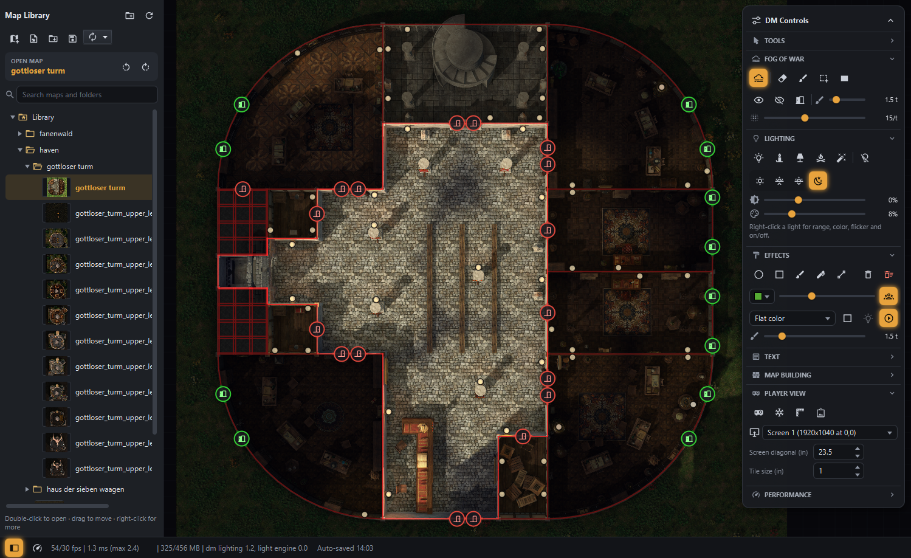

# Dungeon Master Map Tool

Dungeon Master Map Tool is a desktop tabletop RPG tool for games at the table, online, or both. Bring your own maps and play with any game system, or use the fully integrated Daggerheart tools.

Import universal VTT maps (`.dd2vtt` / `.uvtt`) or build a map from your own images. Manage fog of war, lighting, tokens, effects, handouts, and audio from the DM view.

## Ways to play

- **At the table:** Use the app offline on one computer, or show a separate player view on a TV, projector, or table monitor while keeping your DM controls private.
- **Online:** Host a session from the desktop app and invite players to join in their browsers. Players can connect on the local network or remotely through a VPN or secure tunnel; they do not need to install the app.
- **Hybrid:** Use a player display at the table and invite players to the same session through their browsers, whether they are in the room or elsewhere.

[DM Link](docs/DM_LINK.md) is a separate option for controlling the host app from another computer on a trusted LAN; it is not how players join a session.

## Integrated Daggerheart system

Daggerheart is fully integrated, not just a map theme. Host an Online Play session, including on a local network at the table, to use guided character creation and level-up, persistent browser character sheets, a built-in compendium, shared dice rolls and chat, and automated game mechanics. Sheets track resources, equipment, and effects; situational and narrative decisions remain with the group.

The DM can also import Daggerheart adversaries, place their tokens, open their statblocks, and track HP and Stress on the map, even without an online session.

## Get started

Download the [latest release](https://github.com/Bowtie8904/DungeonMasterMapTool/releases/latest). On Windows, unzip `DungeonMasterMapTool-windows.zip` and run `DungeonMasterMapTool.exe`; Java is included. Linux and macOS releases require Java 25 or newer. A second display is optional, but needed for a separate player view.

## Documentation

- [User guide](docs/USER_GUIDE.md)
- [Online Play: browser sessions](docs/ONLINE_PLAY.md)
- [DM Link: LAN remote control](docs/DM_LINK.md)
- [Settings reference](docs/SETTINGS.md)
- [Local control API](docs/API.md)
- [Windows graphics troubleshooting](docs/INSTALLATION.md)
- [Build and development](docs/DEVELOPMENT.md)
- [Daggerheart catalog data](docs/DAGGERHEART_DATA.md)
- [Stream Deck plugin](streamdeck-plugin/README.md)

The interface is currently English-only. For development setup and tests, see [Build and development](docs/DEVELOPMENT.md).
