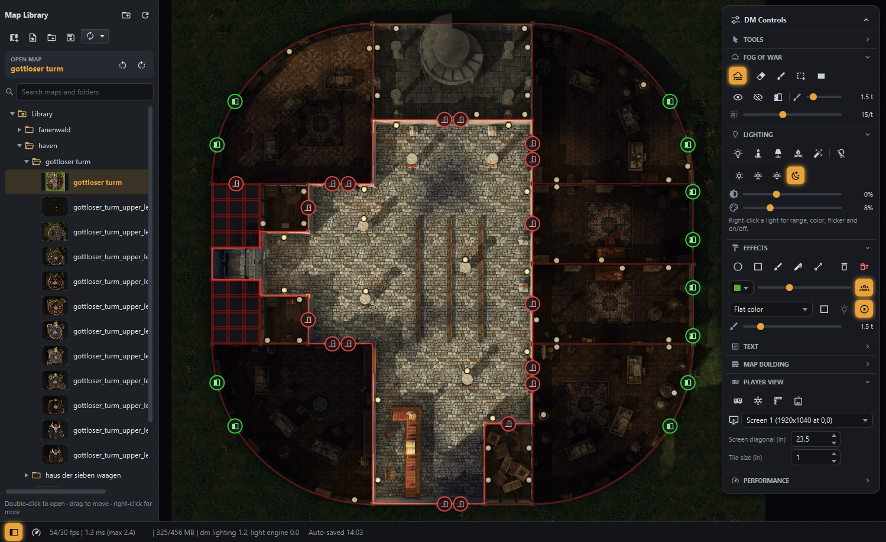
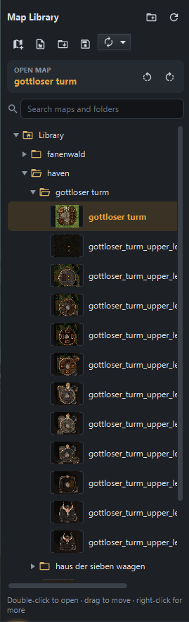
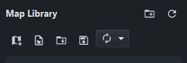
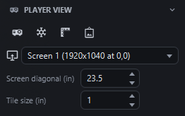
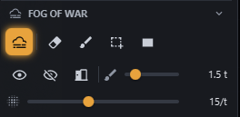
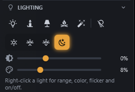
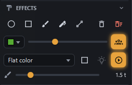
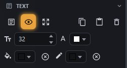
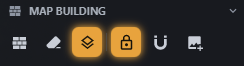
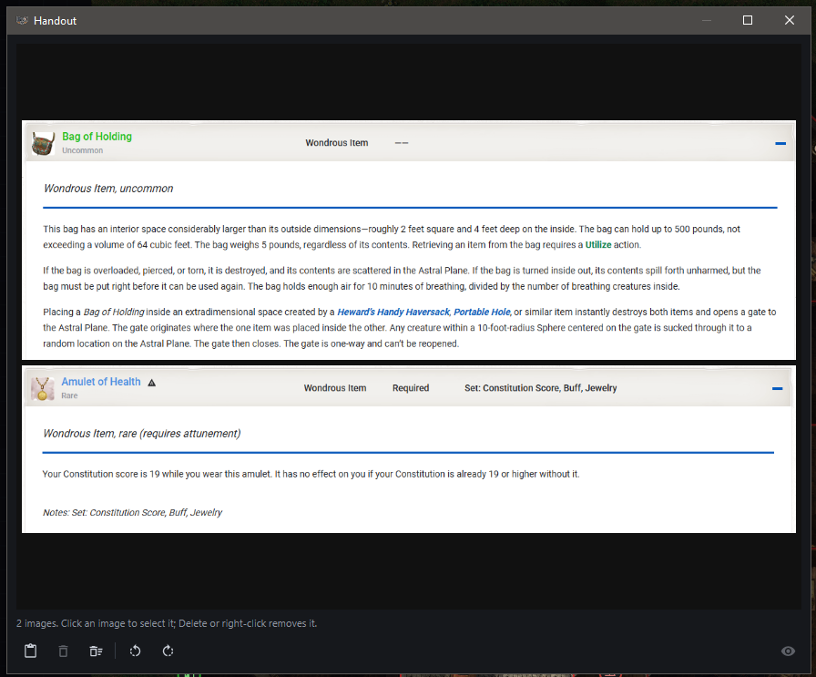

# Dungeon Master Map Tool

[](https://github.com/Bowtie8904/DungeonMasterMapTool/actions/workflows/build.yml)
[](https://github.com/Bowtie8904/DungeonMasterMapTool/releases/latest)


A desktop application for tabletop game masters who run in-person sessions with a **TV or monitor lying flat on the table**. Import a battle map, control everything from your own screen (DM view) and show players a clean, live view (player view) on a second display, with fog of war, dynamic lighting, effects, handouts and more.



## Online play (players in browsers)

The **Online Play** tab (next to DM Link) lets you host an optional, DM-controlled web session for players
who join from a browser. **It is not DM control** (that is DM Link below); players get restricted access.
Nothing starts until you click **Start online session**, so offline play and the second-screen view are unchanged.

- **Full Stress:** Marking every Stress slot automatically applies Vulnerable and its token badge.
  Clearing any Stress removes it only if full Stress applied it. Vulnerable from another source is preserved,
  and the automatic source is remembered across saves and reloads.

- **DM actor resource bars:** Player-owned and testing Daggerheart actor tokens in the selected campaign show compact
  marked HP and marked Stress bars over the bottom of their artwork, with marked/maximum numbers.
  Each bar is empty at zero marked slots and fills as slots are marked, matching the character sheet.
  They match the sheet's red HP and purple Stress colors and stay within the token footprint.
  A gray shield on the left shows remaining unmarked Armor slots; a yellow star on the right shows
  current Hope. Both use enlarged icons with bold numbers and update from the saved sheet.
  They refresh from saved character sheets and are visible only on the DM map, never on player screens
  or browser maps. Hidden and disabled player actors retain their bars, and testing actors qualify without
  a player owner; ordinary tokens and other unowned actors do not.

- **Battle Cry (Daggerheart):** its once-per-long-rest action offers allies a chat claim to clear 1 Stress
  and gain 1 Hope. Each other player may claim once; hearing and attack advantage are resolved at the table.
- **Domain-card review:** all 236 cards and each grimoire spell have an individual disposition in
  [plan.md](plan.md#individual-domain-card-disposition-ledger), followed by the complete open-decision list.
  Costs, dice, passives, limits and ally claims use the class patterns; target fiction remains table-managed.
  Host-dependent audited actions require the optional `domainCardAutomationV3` capability.
- **Grace and Codex workflows:** successful casts expose their payments and damage in chat; cast-time
  limits remain attached to the roll. Tava's Armor and Parallela can target offline actor sheets,
  with Parallela consumed through a preselected attack option. Invisibility spends the caster's
  tokens when its recipient acts. Inspirational Words refills on long rest without preparation
  controls, and recipient choices are reported in chat. Never Upstaged gains tokens through the
  damage dialog and preselects spending its pool for the printed damage bonus. Share the Burden transfers Stress and
  awards Hope atomically to one accepting ally. Safe Haven grants caster and entering allies an
  extra downtime move until their next rest, including casting directly from downtime.
  Copycat embeds a usable card from another actor's active loadout; its half-level Hope cost rounds up,
  and its searchable picker keeps Cancel visible while the card list scrolls.
  Endless Charisma rerolls either the Hope or Fear die once per original non-attack trait roll, never both.
  Teleport spends its once-per-long-rest use on the Spellcast attempt even when it fails.
  Grace-Touched substitutions are intentionally manual.
- **Prepared attacks and damage:** Boost pays Stress before the attack; Smite holds a charge for doubled
  magic weapon damage. Signature Move uses a d20 Hope die and linked success recovery. Runic Adrenaline
  offers a d8 advantage die with marked HP and its paid d8 after the trait roll. Never Upstaged and Sigil
  spend their complete pools; Not Good Enough rerolls damage 1s/2s from an action on the damage result.
- **Blade and Midnight roll actions:** Whirlwind, Glancing Blow (half Proficiency rounded up),
  and successful-Spellcast Eclipse offer chat buttons. Versatile Fighter offers a highest-trait
  attack selector and a Stress-paid individual damage-die maximizer. Rage Up carries its attack
  bonus to that attack's damage, with one spinner selecting one or two uses; Reaper's Strike is an attack option.
  Glancing Blow opens the normal damage window at half Proficiency, retaining damage options.
  Pick and Pull and Uncanny Disguise's avoid-scrutiny advantage exclude weapon attacks.
- **Midnight effects:** Uncanny Disguise replaces its tokens when activated and preselects spending
  one on action rolls, never reactions. Phantom Retreat toggles a buff that also ends on rest.
  Vanishing Dodge applies Hidden until manually removed. Dark Whispers links Stress to Spellcast;
  Mass Disguise creates a Countdown (8). Spellcharge automatically stores tokens for actual magic-damage
  HP and reports them in chat. Night Terror chooses Fear from the live pool and reports its d6 damage.
  Vitality offers its permanent two-benefit selection, including on testing characters, as a buff hidden
  from the left sidebar. Remove it only in sheet edit mode to reverse its benefits.
- **Grimoires and protective effects:** nested spells have their own host-validated sources and target
  pickers. Counterspell vaults only after its successful reaction. Shield Aura moves between recipients
  when recast; Vital Ward chooses resistance type; Tava's Armor and Parallela grant targeted effects.
  Flight replaces its tokens with current Agility (minimum one), and long-rest preparation regenerates
  Inspirational Words, Restoration, Strategic Approach and Fane tokens automatically.
- **Touched-card passives:** Arcana, Blade, Bone, Splendor and Valor automatically apply their passive
  bonuses while at least four matching domain cards are in the active loadout. Vaulted cards do not count;
  Codex, Sage and Dread also offer loadout-gated roll options; Bone's attack avoidance and Splendor's damage
  replacements use the same gate. Their other benefits are not yet fully automated.
- **Mending Touch:** heal 1 HP or Stress for 2 Hope without a use limit, or use its shared once-per-long-rest
  upgrade to heal 2. Choose a character in the target picker and confirm the narrative condition at the table.
- **Dark Army and Thorn Skin:** their summon/cast use limits are tracked separately from token spending,
  and their unspent tokens clear on a rest. Confirm Dark Army's Spellcast success at the table.
- **Arcane Barrage:** choose how much Hope to spend and roll that many d6 magic damage dice; canceling
  or a disconnected send does not spend Hope or its rest use.
- **Armorer and Fortified Armor:** their Armor Score and damage-threshold bonuses apply while armor is equipped.
- **Blink Out:** after a successful Difficulty 12 Spellcast roll, choose the Hope to spend from the chat action; teleportation is resolved at the table.
- **Book of Homet:** Pass Through and Plane Gate use their printed difficulties and independent rest limits; only successful rolls consume a use.
- **Banish:** roll its difficulty from the Spellcast result in chat; the highest d20 is stored on the card and can be adjusted manually.
- **Arcana-Touched:** with four Arcana cards in the active loadout, swap the Hope and Fear dice of a roll from chat once per rest.
- **Blood- and Valor-Touched:** their loadout-gated Evasion and damage rewards are applied by the character sheet and damage dialog.
- **Codex-Touched:** swap it for a chosen vault card once per rest without paying Recall; its Stress-paid Spellcast bonus remains independent.
- **Midnight-Touched:** add an attack’s Fear die to damage for Stress, or gain Hope at zero Hope once per rest when the GM would gain Fear.
- **Frenzy and Healing Field:** Frenzy's bonuses and Armor restriction apply while its effect is active; end it when combatants are no longer in sight. Healing Field offers free or Hope-paid healing, with allies claiming their own healing.
- **Eldritch Flesh and Power Through Pain:** marked Stress increases damage thresholds; marked HP increases damage rolls respectively.
- **Shadowhunter and Voice of Reason:** toggle low-light benefits on Shadowhunter; Voice of Reason offers its situational advantage and its extra damage die when Stress is full.
- **Dread-Touched:** mark Stress from a successful Fear roll to prevent the GM gaining Fear; confirm success with the GM if the Difficulty is hidden.
- **Deadly/Uncanny Focus, Critical Inspiration, and Magic Immunity:** focus ends automatically with the scene (or can be removed earlier); nearby allies can claim their critical-attack benefit, and Magic Immunity negates magic damage while active.
- **Grimoires and Lean on Me:** several spells now use their printed difficulties, Runic Lock tracks successful casts per rest, and one consoled ally can claim Lean on Me’s Stress clearing.
- **Conjure Swarm:** conjure armored beetles for Stress; incoming damage consumes their automatic severity reduction unless Hope is spent to retain them.
- **Weave the Flesh:** mark HP to offer allies a healing choice, with an optional Stress-paid upgrade to both benefits.
- **Safe Haven and Specter of the Dark:** Safe Haven's extra rest move has no additional Hope cost; Specter grants physical immunity until its effect is manually ended.
- **Spellcast difficulties:** Final Words, Forest Sprites, Resurrection, Rift Walker, Salvation Beam, and Veil of Night use their printed difficulties; subsequent effects remain manual.
- **Sorcerer automation:** select damage dice in chat for Volatile Magic rerolls or Manipulate Magic doubling;
  Manipulate Magic also offers reach, +2, and additional-target choices on eligible action rolls. Channel Raw
  Power selects and vaults a domain card for Hope or a one-use damage bonus. Elementalist saves a creation
  element and offers Hope-cost bonuses; Transcendence grants two selected buffs. Minor Illusion, Natural
  Evasion and Enchanted Aid roll their dice in chat. Damage-die edits also post a before/after summary.
  Enchanted Aid's unlimited d8 Help roll is independent of its manual/chat Spellcast swap, which share
  a clearly grouped once-per-long-rest counter. Arcane Charge has paid/free activation and a default-on
  magic-damage mitigation choice; its long-rest buff can be spent for +10 magic damage. Narrative
  prerequisites and the alternative +3 reaction Difficulty remain table-managed.
- **Player map layout:** no top-center session, map or account header obscures the map. A slightly transparent
  connection badge sits in the bottom-left **Connected players** overlay, including while reconnecting.
- **Player token controls:** left-click a controlled token with Select, or box-select several. Selected tokens
  have dashed square outlines and a small rotation handle (on supporting hosts). Drag the handle to rotate;
  arrow keys with the map focused move selected tokens by half a tile. The host still enforces control,
  pause and movement restrictions. Browser doors/windows use light-gray round icons, changing their glyph
  rather than color when opened; no portal segments are drawn. The DM and players can right-click tokens to
  toggle Hidden, Restrained, Vulnerable, or multiple named custom conditions. Condition badges appear on
  tokens using bundled icons (Hidden is invisible, Restrained has its own icon, and Vulnerable uses the
  concentrating icon). Custom conditions choose an unlabeled icon when added, defaulting to bleeding;
  the three built-in icons are reserved and the current choice is highlighted. Actor tokens also receive linked effects (Hidden is a buff; the others are debuffs),
  and removing a linked effect clears its token badge. Token menus suppress the native browser context menu.
  Restrained tokens cannot be moved by players, but the DM can still move them.
  Moving, rotating or resizing tokens preserves their conditions, including through undo/redo.
  Removing a linked effect saves the sheet before updating its token, avoiding competing saves and false version-conflict messages.
  Actor conditions persist on the character sheet across map switches and token deletion. Fresh actor
  tokens inherit those conditions, and revisiting a map refreshes existing actor tokens from the sheet.
  Explicitly removing an actor condition clears it from that actor's tokens; non-actor conditions stay token-local.
- **Door/window locks:** right-click a door or window on the DM map and toggle **Locked**. New and legacy
  portals default to unlocked; locks are saved with the map and support DM undo/redo. Locked portals show
  a small amber padlock on the DM badge only. Players left-click badges with Select to open/close unlocked
  portals while unpaused; locked portals and paused games ignore player clicks without changing their
  appearance. The DM can still open/close locked portals. Browser controls require a supporting host;
  DM Link now requires compatibility version 7 on both machines because map snapshots include locks.
- **Campaigns** are separate from maps: each has a game system (currently Daggerheart; no gameplay effect yet),
  players (username + password, set/reset by you), actors (artwork, owner, a mock character sheet that is not saved),
  and per-player fog memory that survives map switches, sessions and browsers. Campaigns live in
  `online.campaignsDirectory` (default: a `dmmap-campaigns` folder beside the settings file; the older `campaigns`
  folder is not migrated).
- **The tab** shows a session card (active campaign, status, invite link with copy button, Start/Stop) above four
  subtabs. Everything is managed with tables and right-click menus; F2 renames and Delete removes:
  - **Campaigns:** name, system, player and actor counts. Select a row to make it active; right-click to open,
    rename, create or delete. *New campaign* asks for a name and a game system.
  - **Players:** username, password state, owned actors and online status with ping. Right-click to set the
    password, rename, kick, add or delete (renaming, a new password or deleting signs the player out).
  - **Actors:** a folder tree with all folders expanded by default and each actor's artwork (default token art when
    none) and owner. Folders can still be collapsed. Right-click for owner, artwork, rename, remove, place at view
    centre and folder management; drag actors and folders into folders, or **drag an actor straight onto the map**
    to place it there (like the token browser).
  - **Connected:** connected players with their open tabs and ping; right-click to kick.
- **Connected players overlay:** while hosting, the bottom-left of the DM map shows the same roster as
  the browser: account color dots, player names and current character identities, and live ping in
  milliseconds (`--` until measured). The Dungeon Master has a colored **Host** row, and the heading
  shows whether the session is live or paused. It refreshes even with the Online Play sidebar closed
  and does not intercept map clicks. Character pronouns, when present, appear as
  `username (character [pronouns])`; both rosters grow with their contents and wrap at the map edge.
- **Roll context:** feature actions and Spellcast rolls have a subtle, collapsed **Source** section in chat.
  Reports from chat action buttons (including Marked For Death and Death Strike) also show the activated
  feature's description and origin, retained in saved chat history rather than the original weapon's source.
  Expand it to read the feature, card or individual grimoire spell without opening the sheet.
  Spellcast titles name their source; descriptions stay with history, follow-up spell damage and rerolls.
- **Witch automation (Daggerheart):** Commune rolls its Spellcast-trait d6s in chat with the sensory chart.
  Witch tokens and the Lunar die are tracked only on their feature cards, not as header class resources.
  Enchanted Talisman asks for Hope, tracks protective tokens and creates transferable loot; its holder can
  spend those tokens in incoming damage, automatically reducing the creating witch's pool. Depletion or
  the witch's rest removes the item. Walk Between Worlds and Night's Glamour roll Spellcast against 13
  with a success-only spirit-entry chat action and an automatic Glamour buff on success. Spirit/Circle tokens have spend buttons; Circle grants party-wide
  thresholds, Evasion and preselected attack bonuses. Moonbeam grants a scene-duration Spellcast bonus.
  Vexing Malison and Glamour offer situational advantage. Glamour can be maintained for Stress when
  taking or dealing damage. Lunar Phases tracks its session d6, its Hope-cost once-per-rest increase,
  and the current mitigation/damage/threshold/Evasion benefit. Range remains table-confirmed; remove
  out-of-range buffs manually. Witch actions require an updated host.
- **Blood Hunter automation (Daggerheart):** Blood Maledict, Crimson Rite and Veilwalker create buffs with
  optional roll bonuses; Chasing Death adjusts Rite costs and dice from current HP. Grim Psychometry checks
  Spellcast against 12 and offers its Stress-cost vision in chat only on success. Lycan bonuses require Wolf
  Form; players still select the Werewolf transformation themselves. Mutagens adds a free, restricted option
  to either rest, with chosen trait increases/decreases and automatically unlocked benefits. Mastery changes
  traits to +2/-2; Volatile Toxins permits two benefits and locks its marked HP until the next rest of either kind.
  Downtime choices and individual buffs describe each benefit; Volatile Toxins expands to its own feature
  description. Benefit actions, roll options and stat changes appear on the resulting buffs. Shadowed Grit
  is offered only on Fear-generating rolls, never reactions.
- **Brawler automation (Daggerheart):** with both weapon slots empty, **I Am The Weapon** equips a generated
  **Brawler's Strike**, offers its attack-trait choice, scales both d8 and d6 pools with Proficiency, and shows
  the +1 Evasion buff. **Combo Strike** is an optional Melee damage-roll cost; the host rolls until a lower
  Combo Die appears and adds every face, including that final die, without modifying Combo Dice. Its die
  can advance once per tier. **Overwhelm** appears on attack chat, **Surrounded** has an editable Hope cost
  starting at 1, **Eye for an Eye** appears in incoming damage, and **Pummeljoy** upgrades critical Melee
  rewards and that attack's damage Proficiency. **Not Done Yet** automatically offers Hope or Stress
  recovery when the final damage is Severe.
  **Martial Artist:** choose two tier-1 stances in character creation and another tier-eligible stance each
  level. The separate **Focus** feature tracks Focus (maximum 6) and refocuses once per rest during calm.
  **Stance Fighter** opens a known-stance picker, showing a trait choice only for Favored.
  Older characters can fill their missing stance choices there; testing builds know
  every stance at their tier. A shift costs 1 Focus, replaces the previous descriptive stance buff, and
  ends on Severe damage, the last HP, manual dismissal, or scene end (remove it in Effects).
  At Instinct 0 or lower, refocusing clears Focus to 0 without rolling.
  Existing sheets retain their Focus and spent Refocus use when the controls move to the Focus feature.
  Stance descriptions use the supplied rules verbatim; Brawler's Strike chat sources include I Am The Weapon.
  All sixteen stances have their applicable stats, roll options, mitigation or chat/feature actions wired;
  positional conditions, attack success, target Severe damage and target track changes remain
  table-confirmed. Aggressive adds an extra die and drops the lowest **in each weapon damage pool**;
  Exacting replaces damage ones with their maximum on the host but never changes Combo Dice.
  **Keen Defenses** reports Evasion for one attack; **Focus Cannon** has a costed Instinct roll, standalone
  damage, and damage on its own chat card. **Flow State** adds Stress-funded shifting and Focus-funded
  Combo Strike. Update the host for Combo Strike and Exacting; older hosts disable these unsupported rolls.
- **Highborne Privilege:** the situational advantage option is available on non-attack action rolls, never attacks.
- **Testing characters (Daggerheart):** right-click the Actors tree or a folder and choose **New testing
  character**, then assign its **Owner** as usual. The assigned player (including a player account used by the DM)
  opens its sheet and uses **Edit testing build** to freely switch level, class/subclass, subclass stage,
  multiclasses, ancestry/mixed ancestry, community and transformation. Features, domains, spellcasting and
  class/card resources update automatically; all domain cards in the available domains, at every level, are
  active together, with no five-card limit. New testers start at level 10 with mastery features and starter gear.
  Equipment and notes survive build changes; obsolete features, resources and their effects are removed.
  The editor uses the full available dialog height for its scrolling form, with validation messages and
  Cancel/Apply controls kept in the footer.
  All six base traits can be set freely with integer number spinners, including negative values; Apply saves
  them without the normal creation-array or advancement limits.
  Testing characters are visibly marked and permanently testing-only: players cannot enable testing on normal
  actors, and normal character creation, advancement and loadout limits still apply.
- **Actor tokens** are stored in the map file; older builds still open such maps. Actor tokens of other campaigns
  are flagged in the Actors tab and can be removed there (never automatic).
- Share the invite link; players pick their name and enter their password (failed logins are rate limited).
  Each account allows only one browser login session at a time; occupied accounts disappear from the
  automatically refreshed login list. Tabs and sheet pop-outs in the same browser session still work.
- **Campaign notes:** the browser's **Notes** sidebar tab sits between My actors and Compendium.
  Create named plain-text notes and nested folders; right-click notes or folders to create, rename or delete
  (deleting a folder confirms removal of its contents). Double-click a note, or press Enter, to open a draggable,
  resizable editor. **Save** (Ctrl+S/Cmd+S) persists the text; **Reload** reads the latest saved version.
  Unsaved drafts are protected when closing or logging out, and editor size is remembered in that browser
  per campaign/player. Each player's notes are private to that account; the permanent **Group Notes** file
  is readable and editable by every campaign player, including players added later. Concurrent stale saves
  are rejected without losing the draft: copy it before reloading and merging the latest text.
  Notes and folders live on the host inside the campaign (`notes/players/<playerId>/.../*.txt` and
  `notes/group.txt`), survive session restarts, and are included when copying/backing up the whole campaign.
  Private means other browser players cannot access them, not encryption against the host's filesystem owner.
  Notes and Compendium also have a **Pop out** title-bar button, like character sheets. Each opens in an
  independent, resizable browser window that continues working after the map tab closes. Popping out a note
  saves pending edits first; blocked pop-ups or failed/conflicting saves keep the original editor and draft.
  A Compendium pop-out can still browse, search, filter and add entries to owned characters: **Add** opens/focuses
  the receiving character sheet and applies the entry there, preserving its unsaved changes.
- **DM character sheets**: while hosting a Daggerheart campaign, double-click a player-owned actor in the Actors
  tree or its map token with Select to open its sheet inside the DM view. Right-click an actor and choose
  **Open character sheet** for the same action. Windows are non-modal, draggable and resizable; reopening an actor
  brings its existing sheet forward. Offline players' sheets are available too. The DM uses the same sheet and
  rules as players, acting on behalf of the character's owner. Saved changes synchronize live in both directions,
  including resources, equipment and notes. Concurrent stale saves are rejected with an explicit message instead
  of overwriting newer changes. Actor placement remains available through drag/drop and **Place at view centre**.
  The actor and character sheet share one name: renaming either updates both actor lists and future chat identities;
  past messages keep their original names.
  Normal closing saves pending edits first. Sheets close when hosting ends or changes; DM access never requires
  logging in as a player.
- **Player actor list:** My actors uses compact rows with a portrait, prominent character name,
  smaller class/subclass text and a separately divided level. Double-click a row to open/focus its
  sheet, or focus it and press Enter/Space. Row text is not selectable, and single-clicking no longer moves the camera. Disabled and
  testing indicators remain visible; token customization and pop-out controls are inside the sheet.
- **Daggerheart character sheet**: players open sheets from My actors.
  **Edit mode** is off by default; its labeled On/Off switch sits beside the sheet title
  and is hidden when minimized, with extra spacing from the title and a muted gray label while off.
  Enable it to edit the character name, portrait (hover/focus for **Edit image**),
  base trait modifiers (-99 to +99, excluding buffs), Proficiency, transformation, Experiences and Background.
  Character name edits (including Background Name) save only after leaving the text field, not during typing pauses.
  Background pronouns appear beside the name when provided and update as you edit them.
  In edit mode, resource pips change the usable maximum: locked slots enable through the clicked slot;
  enabled slots disable themselves and later slots. HP locks remain protected. Manual Armor adjustments
  appear separately from equipment/buffs as **Manual override** in the hover breakdown.
  Evasion is also editable as its base value. HP/Stress capacity, Proficiency, trait and Evasion edits
  are tracked with Armor in one persistent **Manual override** effect, visible only in the sheet's
  Effects tab, not the left-side overlay. Removing it in edit mode reverses the tracked adjustments.
  Its source is labeled **sheet edit mode**; its redundant Armor badge is hidden, while other buffs
  retain their modifier badges.
  Domain cards gain a character-local delete button beside their chat links in Card and List views.
  Outside edit mode, normal rolls, Hope and resource marking still work; disabled sheets remain read-only.
  The sheet opens as a draggable window over the map (Character, Domain Cards, Equipment, Loot,
  Background tabs) and can be popped out to its own browser window. Trait, Hope-feature and Experience rolls open
  a duality roll popup (advantage, Experience, difficulty) and appear in the chat with Hope/Fear dice and outcome.
  All six traits stack vertically in a persistent left sidebar, visible on every tab. Experiences are in Background.
  The Character tab places class/subclass features in the left column and heritage features in the right;
  these columns stack when the sheet is narrow. Evasion, Armor, Thresholds, HP and Stress remain in a compact main-area row.
  Narrow Evasion and Armor cards leave room for single-line HP and Stress tracks at the default sheet width.
  Armor, HP and Stress slots are equally sized squares; tracks wrap instead of shrinking slots.
  The Armor container reserves space for two rows of six slots, leaving the remaining width to HP and Stress.
  Trait tiles use highlighted teal borders to stand out from the other character stats. A read-only ring in each
  tile's top-left corner shows a dot when marked without increasing the tile height; only level-ups mark or clear traits, not manual clicks. Short rest,
  long rest and death-move controls are in the header to the right of the portrait, between the character details and vitals row. The resizable sheet
  defaults to 900 px wide (clamped to available space) and nearly the full viewport height, leaving 30 px above and below.
  Trait cards shrink with the available sidebar height (hiding example actions, then switching to compact one-line rows) so all six stay readable on small screens or with extra class resources; only if even that does not fit, the sidebar scrolls independently from the tab content; floating and pop-out sheets use the same layout.
  **Death moves** become available when all HP are marked. Confirm **Blaze of Glory** to post the critically
  successful final-action/death instructions, or **Risk It All** to roll Hope/Fear d12s and share the outcome
  with a sender-only **Apply recovery** chat button (or **Clear all HP and Stress** on a critical).
  **Avoid Death** rolls a Hope d12, applies **Unconscious**
  and adds a permanent scar if the die is at or below your level. Unconscious blocks token movement only;
  actions and attack targeting remain under table control. Clearing at least one marked HP or completing
  a long rest removes it; it can also be dismissed in Effects. Scars cross out Hope slots and survive rests
  and reloads. Use **Scars** below Hope for GM-approved adjustments/healing; record their narrative impact
  in Background. All death-move results are public and rolled by the host.
  Death-move options include carried Reliquary/Phoenix bonuses, optional Blessed Hope spending and one
  Mask token after confirming the mask is worn. Mask tokens are manually gained/adjusted and capped at four.
  Raw matching dice remain critical; otherwise adjusted Hope equal to or above Fear succeeds, using adjusted
  Hope for recovery. Reanimated characters can confirm **Won't Stay Dead** on a failed Risk roll to permanently
  mark one HP; permanent HP stay marked through healing/rests, and permanently marking the last HP means death.
  **Spectral Form** clears one HP and grants physical resistance and wall/door traversal until further healing
  or the last HP is marked; its expiry report asks the GM to reposition a token inside solid objects.
  **Cathartoid Egg** consumes one carried egg and records the avian transformation without altering the build.
  **Battle-Hardened** spends one Hope once per long rest to clear one HP; **Unbreakable** clears a host-rolled
  d6 HP and moves the active card to the vault. **Life Ward** costs three Hope, protects one ally with
  table-confirmed Close range, and automatically clears one HP instead of a death move. Wards end when used,
  recast or their caster completes a long rest, including offline allies.
  Hover or focus Evasion, Armor or Thresholds to see their sources in an overlay above the tabs, without adding scrollbars.
  Sheets are saved on the host per actor (`<campaign>/sheets/<actorId>.json`, debounced autosave) and reload on
  the next visit. A new actor starts with an empty sheet that offers the **Character Mancer**.
  The DM can right-click an actor in Online Play to disable or re-enable it. Its assigned player can still
  read the disabled sheet, marked beside the character's name, but cannot edit it, use its actions, or move
  its token; navigating the read-only sheet does not save it, and the DM retains control.
  Disabled actors are excluded from targeting, transfers and actor-based automation. Previously applied
  effects remain in place, and re-enabling restores access.
  Domain-card counters labeled "Tokens" sit in each loadout card's header between its domain and recall cost;
  loadout and vault cards are displayed in ascending level order without changing their saved order. Domain-card
  action groups have no enclosing border, while individual buttons retain their normal styling.
  Ancestry actions perform their configured attacks, damage and checks instead of only spending resources.
  Feature checks such as Unshakable show a concise consequence below the dice and include the full feature in Source.
  Firbolg and Centaur Charge reactions on Agility roll cards spend one Stress and post a fixed 1d12 damage roll.
  Hallowed Aura and Luckbender can react to other players' action rolls; Fearless and Hallowed Aura update the
  original roll to **with Hope** without changing its dice, including its available follow-up actions.
  Hope-result chat rolls offer the original roller a one-time **Gain 1 Hope** button. Criticals instead offer
  **Gain 1 Hope / Clear 1 Stress**. Outcome conversions no longer grant Hope automatically; claim it on the
  converted roll. Claims are saved on the host and stay consumed after reloads. At maximum Hope the button
  is disabled, except a critical can still clear marked Stress; capped rewards are not consumed.
  **Seraph:** Roll Prayer Dice once per session without a confirmation; the feature shows its remaining session use.
  Manage individual values only in the compact class-resource group: the face, a highlighted yellow **+** to gain Hope, and **x** to remove
  a manually used die. Each die uses an independent random sample; d4 repeats are normal, especially with Devout.
  Each die can reduce incoming damage, add to any chat roll (including an ally's), grant Hope, or be removed for
  manual use. Devout rolls an extra die and drops the lowest, and grants a second Sparing Touch use; healing reports
  name the recipient. Spirit Weapon adds a Stress-spend button to weapon attack chat. Sacred Resonance defaults on
  for Melee/Very Close/Close weapon damage and doubles matching values across all kept damage dice, including bonuses.
  Its extra damage appears on the Sacred Resonance breakdown row; each dice source retains its base total.
  Explanatory breakdown notes wrap within both browser and native DM chat cards, including saved rolls.
  Ethereal Visage offers **Remove 1 Fear instead** beside Gain Hope on successful normal Presence-with-Hope rolls,
  never reactions; either claim consumes the reward. Removal needs no confirmation and announces the GM Fear change
  in chat. With hidden difficulty, selecting this reward asserts that the roll succeeded.
  Power of the Gods automatically upgrades Wings of Light to d12. New host mechanics require Seraph-capable hosts.
  Rerolls produce a single roll card. Limited uses persist across reconnects and host restarts; the DM resets them
  with **End scene** (per-scene uses and scene-duration effects) and **New session** (also per-session uses,
  session-duration effects and session token pools). Both post a highlighted announcement in the chat.
  Changing Hope, Stress, HP, Armor, Proficiency, gold or a resource pool on the sheet immediately enables or
  disables the affected feature, item and card action buttons; no tab switch is needed.
  Ignition is a primary-weapon damage option, paid once while its removable buff is active. Retract preselects
  physical resistance and action-roll disadvantage and prevents player token movement (the DM can still move it).
  Surefooted, Natural Climber and Hunter's Nose appear as applicable trait-roll options; suggested advantage or
  disadvantage can be overridden, while selected Surefooted prevents a disadvantage die.
  Elf Quick Reactions is also an optional roll modifier for reaction rolls: mark 1 Stress for advantage,
  charged only when the roll is sent successfully. Its separate sheet action remains available.
  Lifespring and other configured healing actions select and heal a character; Eye of the Storm selects a
  character for +1 Evasion until the caster takes Severe damage or recasts. Luckbringer grants Hope to all
  actors belonging to currently connected players.
  Rogue Nightwalkers can roll Dark Cloud against difficulty 15. Syndicate Contacts Everywhere prepares a
  shared buff: choose +3 to either Duality die after an action roll, or use its preselected 2d8 damage bonus.
  Reliable Backup raises its session uses to three and adds a one-HP mitigation and a conversational Presence
  roll with a d20 Hope Die. Using any one benefit ends the buff; equal adjusted dice are a critical success.
- **Daggerheart Character Mancer and level-up guide**: a new actor's sheet only shows a "Start the Character Mancer"
  prompt. The wizard shows one small choice per step (class, subclass, ancestry, community, an optional transformation,
  traits, primary weapon, secondary weapon, armor, supplies,
  background, Experiences, domain cards, connections, identity, review) with Back/Next and a progress bar, and builds
  the full sheet from the compendium. The sheet's **Level up** button starts a second wizard (tier-milestone Experience,
  two advancement points, per-advancement details, new domain card, optional card swap). All choices are remembered
  in the sheet (`mancer.choices`, `levelUps`). **Level up** is disabled until character creation is complete.
  Clank's Purposeful Design adds an Experience selection during creation and permanently increases that
  Experience by +1; mixed ancestry only grants this choice when that feature was selected.
  The advancement slot counts per tier are defined in an
  editable table (`ADVANCEMENT_RULES` in `web/src/daggerheart/rules.ts`). **Transformations** (Hope & Fear, from
  `transformations.json`) are optional: skip the step in the mancer, or add/change/remove one later from the
  "Heritage features" card on the Character page (e.g. when the GM grants it). A character has at most one; its benefit and drawback are
  shown as always-active heritage features and do not count against the domain card loadout. The wizards have a side panel with the full text of the hovered or selected class, subclass, ancestry, community, transformation, gear and domain card; weapons and armor are tables offering only the basic gear (starter flag in the data), and Evasion, Armor and thresholds list their sources on hover. The header labels the original class as "Class:" and any additional class as "Multiclass:".
  Ghost's Ephemeral applies physical resistance/double magic damage in the damage calculator and has a
  2-Stress pass-through action. Shapeshifters choose exactly one ancestry feature when acquired; their
  feature buttons and rest moves change ancestry plus retained feature, or just the current ancestry's feature.
  Existing Shapeshifters must make this choice before using their sheet. Vampire Fangs has attack/damage
  buttons using the highest trait; Feed appears on Fangs rolls (confirm a successful hit on a bleeding target,
  enter HP marked in the styled feature popup, confirm to spend 1 Stress; cancellation spends nothing).
  Feed tracks up to six tokens, loses one per long rest, offers a token-paid
  Fear d20, and suggests disadvantage by default when empty. Wolf Form activates as a rest-expiring effect
  from its feature or HP-marking damage mitigation, adds 1d10 to attacks/damage, and offers a Stress button
  on Hope/critical rolls. Howling Rampage rolls tier d20 physical damage and ends the form.
  Steps with detail previews keep an empty panel visible before selection, so hovering, focusing and selecting
  options only updates its contents without shifting the layout (including on narrow screens).
- **Beastbound Ranger companions:** the **Companion** tab appears between Character and Domain Cards.
  The Character Mancer creates your animal; existing and multiclass Beastbound characters use **Create companion**
  to open a focused companion wizard, including earned training. Track name, animal, Experiences, Evasion,
  Stress, standard attack, damage type, die and range. Commands and attacks use your Spellcast trait,
  attacks use your Proficiency and applicable benefits (including Ranger's Focus), and the roll popup spends
  Hope on companion Experiences. Successful Hope commands offer a chat follow-up for conditional advantage.
  The Beastbound **Companion** feature explains that advantage applies only to your next action when it
  builds on the companion's successful Hope command.
  Level-ups include companion training and milestone Experiences, with extra training when Expert/Advanced
  Training is learned. Training uses selectable cards like normal advancements, with descriptions,
  selection counts and **Remove one** controls; Experience and attack details also use cards.
  **Light in the Dark** adds a specially marked Hope slot after the normal usable slots and before scars.
  Companion attacks use the active-weapon card layout and chat-sharing controls.
  Creature Comfort, Armored, Bonded, Battle-Bonded and both directions of Loyal Friend are supported;
  Battle-Bonded is checked passively at the table. The Loyal Friend button announces its use to chat and
  spends its long-rest use; resolve redirected damage manually. Hold Them Off is a damage roll option
  costing 3 Hope after a successful weapon attack, alongside its normal action button.
  Loyal Friend announces immediately without a confirmation prompt. Companion attacks can be posted to chat
  from saved companion state but cannot be transferred as inventory. Range, successful hits and quiet moments are checked at the table. **Take damage** marks one companion
  Stress regardless of damage amount, or an owner Armor Slot with Armored (including Loyal Friend interceptions). Full Stress makes the animal
  unavailable until the next long rest; it returns with one Stress cleared. Stress-clearing downtime moves
  also recover your available companion. Companion state is saved with its owner and shared by sheet pop-outs.
- **Daggerheart compendium and automation**: the `dmmap-daggerheart` folder (setting `online.daggerheartDirectory`)
  holds the maintained Daggerheart data (armor, weapons, domain cards, classes, ancestries, communities,
  transformations, consumables, items; see `docs/DAGGERHEART_DATA.md`). Players browse it in the **Compendium**
    window (rail button below Notes): category navigation on the left, searchable and filterable tables with
    expandable rows on the right. While hosting, the DM has the same compendium embedded in the app, opened
    with the book icon immediately below Chat on the right sidebar. Drag its header to move it and its bottom-right
    corner to resize it; it has Close but no minimize or pop-out controls. The DM can link entries to public chat
    and add equipment, loot and domain cards to any player-owned campaign character, even while the player is
    offline (create the character sheet first). Additions persist immediately and update open player sheets;
    quantity caps are enforced. The window closes when hosting ends. Hide the icon in Settings with
    `online.compendium` under hidden controls; the local API control `online.compendium` remains available.
  - **Guided JSON catalog editor:** in the DM compendium, choose **Edit JSON catalogs**. Browse/search all nine
    catalogs, edit an entry, or use **New entry** / **Duplicate as new**. **Overview**, **Features**,
    **Automation** and **Advanced** tabs organize the entry by task. Named features use a list/detail layout;
    automation uses rule cards and focused panels with activation, conditions, effects and costs/limits.
    Breadcrumbs navigate deeper structures without nested accordions. Every field has inline guidance;
    typed inputs, optional-field pickers and ordered lists work without raw JSON. Save stays visible,
    and structural edits retain the current panel's scroll position.
    **Add effect** offers concrete operations such as restoring HP, spending Hope or applying a modifier effect.
    Search boxes, feature text areas, numeric fields and dropdowns use readable dark-theme text and placeholders.
    **Save to JSON** validates and atomically updates the configured file. Existing entry IDs cannot change;
    conflicting external edits are rejected and your draft remains available. **Reload file** discards a draft
    only after confirmation. Unsaved navigation/closing is protected.
    Saved catalog rules refresh open compendiums and linked sheets automatically. Current HP/Stress/Hope,
    quantities, spent uses, player choices, advancements and manual overrides are preserved; creation starting
    stats affect new characters only. Custom inventory entries are never linked. Offline/closed sheets resolve
    the latest rules when loaded, and updated catalog metadata is included on their next save.
    This editor is DM-only and shares the compendium's existing hide setting and local API control.
  - **Handouts:** while hosting, a **Handouts** icon below the Compendium opens a file browser for images. The DM
    can create folders, add images from disk or the clipboard, rename, copy, delete and drag files and folders
    between folders (Ctrl copies), and share files with individual players or everyone. Granted files appear in the
    player's **Files** tab (below Compendium) in the same folder with the same name, updating live; players can
    only browse and view. Double-click opens an image window; **Show to all players** opens it for every
    logged-in player and grants access. Hide with `online.files`; the local API controls `online.files`,
    `online.files.import`, `.paste`, `.folder` and `.refresh` remain available.
    The subtle add icon puts armor, weapons, potions, items and domain cards in the
    matching sheet tab, choosing the receiving character when they own several. Sheet domain cards keep their
    natural heights in two balanced columns (one in narrow panels). In level order, each card goes into the
    shorter column, keeping lower levels at the top across both columns without fixed left/right alternation;
    the columns may contain different numbers of cards. Compendium entries cannot be
    dragged onto sheets. Every row also has an inventory-style **Link in chat** icon to share its description
    without adding it to a character or offering inventory for transfer. Add and Link in chat are aligned,
    equally sized icon buttons with a larger, clearly visible plus for Add. Links use the selected chat recipient;
    standalone Compendium pop-outs post to Everyone. Chat links show **Compendium - Section** above the name
    and inventory-style detail badges (including weapon stats, armor thresholds and domain-card details),
    with Markdown-formatted descriptions and individually bordered feature/spell blocks below in both player
    and DM chat. This includes equipment features, ancestry/community/class/transformation features and
    grimoire spells. Entries with
  automation act on the sheet: armor sets evasion, thresholds and armor slots, features and potions get action
  buttons (spend a resource, heal, gain Hope), and buffs/debuffs appear in the sheet's new **Effects** tab - e.g. a
  Control Potion's action report says it gained **Next Finesse Roll +1**, then that effect is removed after the roll.
  The report keeps the potion name as the action source so the item and its effect are distinct. Rest-only moves and
  benefits have no standalone action buttons; use them only in a confirmed rest. Downtime timing, additional moves,
  passive benefits and roll tables are configured in the relevant compendium JSON entries.
  A subtle shield button on the **Thresholds** vital opens a damage dialog, styled like the roll windows. Enter the
  incoming damage and type, then tick an Armor Slot or any armor, card, feature or item mitigation available to the
  character (for example Scales, Shrug It Off or Ring of Resistance). A live preview shows the HP to mark: Minor 1,
  Major 2, Severe 3, and 4 for damage of at least twice the Severe threshold. **Apply** marks HP and Armor Slots,
  pays Hope/Stress/HP costs, counts limited uses, consumes items and posts a damage report card to the chat. Mitigations are
  configured in the relevant compendium JSON entries.
  **Druid automation:** Beastform and Evolution offer all 24 categories, filtered by tier, with base-form and
  hybrid selections where required. The removable **Beastform: &lt;category&gt;** buff supplies stats and an attack
  without altering equipped weapons. Its temporary features appear in a **Beastform** tab between Character and
  Domain Cards; applicable advantages share one roll option listing all applicable activities, and conditional
  attack bonuses remain explicit roll options. Poison damage and Fire retaliation buttons roll an unmodified
  1d10 directly, without bonus selection; poison is separate damage when the poisoned creature acts. Fragile forms
  end on Major damage, all forms end on the last HP, and domain spells cannot be cast while transformed.
  Cannonball posts a claimable ally action: the thrower chooses Agility or Strength and rolls with their own
  stats and Proficiency. Clarity reports total available Stress recovery, Regeneration selects a healing target,
  and Warden's Protection reports its rolled ally count.
  The Character tab has one searchable **Features** block, ordered Hope, class, subclass, ancestry,
  community and transformation features. Card view uses the same two-column, height-balanced flow as
  domain cards (one column on narrow sheets). Its compact Card/List switch is independent of the
  domain-card preference and stays selected while the sheet is open. List rows show name, source and
  chat link; expand a row to see the full feature, grouped subfeatures and actions. Search includes
  sources and full text, including grouped subfeatures; read-only sheets can search and expand rows.
  Elemental Incarnation, Aura and Dominion each display their elements together on one feature card, with
  their individual buttons; their underlying per-element features remain separate. Channeling replaces the
  previous element and automatically enables the matching Dominion benefit. Aura is once per rest and ends
  when channeling ends or changes. Earth aura gives every player character an **optional +1 Strength** roll
  option: select it only within Close range. Element buttons require their matching buff; Earth Dominion appears
  in damage mitigation, Fire adds its damage die automatically, and Air adds Evasion. Range, narrative
  prerequisites, adversary conditions and forced movement remain table-confirmed.
  Forager and Potioncraft Kit add choices, not extra slots; explicit grants such as Celestial Trance and
  Potion of Stability still increase the number of moves. These rules use metadata,
  not runtime name/label exceptions. Other actions on the same feature or item remain available.
  The Short/Long rest buttons open a **downtime
  dialog**: pick up to two different moves (a move can't be chosen twice; Tend to Wounds, Clear Stress, Repair Armor, Prepare alone/with others; long rests
  offer the "all" versions and Work on a Project), plus extra moves and move types granted by your ancestry, community,
  class, domain cards and items (Clank Efficient and Recovery allow one long move in a short rest, Warlock tribute, Forager,
  Potioncraft Kit, Martial Preparation, ...). Passive benefits you own (Premium Bedroll, Hardy, ...) are listed as
  checkboxes you can untick if you don't use them. **Warrior:** Combat Training allows a two-handed primary
  plus a secondary weapon. Courage is on failed Fear rolls, never reactions; Rise to the Challenge preselects
  the d20 Hope Die at two or fewer unmarked HP, labeled **Hope d20** in the roll options. Slayer has only its header resource: Hope rolls can grant a
  Slayer Die instead, and attack/damage options choose how many to spend. **New session** converts unspent
  Slayer Dice to Hope. Weapon Specialist adds one secondary-weapon damage die for 1 Hope without a use
  limit; its separate once-per-long-rest roll button rerolls only Slayer Dice showing 1. Its feature shows
  that usage counter, not action buttons. Martial Preparation gives all campaign characters its downtime
  move, including offline actors, without extra slots. Characters without a Slayer pool receive a removable,
  one-use d6 buff for attack or damage; Slayers gain a pool die. The feature has no die counter.
  Other passive rest benefits remain
  optional. Confirming rests expires effects, resets uses and posts a styled
    rest report card in the chat (not a typed message) with every move and roll; three short rests in a row require a long rest. Using an item or feature (e.g. drinking a potion) posts a distinct "Action used" card instead of a plain message. Entries without automation stay readable text. Maintain compendium data and automation directly in `dmmap-daggerheart/*.json`; see `docs/DAGGERHEART_DATA.md` for the format.
  **Community features:** Duneborne Oasis offers per-die reroll buttons on current-session short-rest reports,
  including allies' reports, keeping the higher result and updating the original report and additional recovery.
  Each Duneborne character can use it once per rest across all reports; their buttons then disappear until their
  next rest. A formatted action card announces the reroll, kept result and any additional recovery.
  Freeborne Unbound has a sheet button and session-use counter shared with its Fear-roll reaction.
  Hearthborne Close-Knit asks how much Hope to give and which connected ally receives it.
  Feature action cards name their origin without duplicated feature names (for example, **Hearthborne - Close-Knit**).
  Roll-option labels also keep qualifiers without repeating the feature name, such as **Elf - Quick Reactions (reaction roll)**
  and **Orderborne - Dedicated (Hope d20)**.
  Numeric bonuses and token-spend counts sit beside their roll option in a labeled control on the right,
  including damage mitigation and Armor Slot counts. Related dropdowns stay aligned and fit narrow dialogs.
  Each option has its own subtly shaded, bordered panel to clearly separate it from neighboring options.
  Trait roll dialogs offer **Normal roll / Reaction roll** beneath advantage/disadvantage. Reaction rolls are
  marked in player and DM chat and never award the standard Hope or critical Stress recovery.
  Reaction-only options (Elf Quick Reactions and Anchoring Hook) appear only in Reaction mode;
  action-only options such as Dedicated are hidden there. Switching modes discards previous bonus selections.
  Demigod Gifted and Vampire no-token disadvantage apply to both kinds; spending Feed tokens for a Fear d20
  remains action-only. Situational requirements (such as avoiding forced movement) still need player confirmation.
  Orderborne Dedicated can replace the Hope die with a d20 from the roll dialog; Reborne Found Family spends
  1 Hope for an editable ally Experience bonus (default +2). Seaborne Know the Tide has a level-capped token counter
  on its feature, a gain button on Fear rolls and a quantity selector when spending tokens; tokens survive reconnects
  are saved with the sheet and reset to 0 when the DM clicks **New session**. Nomadic Pack and Brave Face spend 1 Hope.
  Your own roll cards in the chat carry buttons: **Damage** on attack rolls (same dialog as the sheet) and feature
  buttons such as Wizard Strange Patterns, Ranger's Focus / Hawkeye rerolls, Fearless or Patron's Boon, and spell
  Damage buttons (Blighting Strike, Siphon Essence, ...) that pick the dice from the roll result. Domain cards only
  offer a Spellcast button when they ask for one; token cards (Umbral Veil, Flight, ...) track tokens; I See It Coming
  rolls its d4 into the chat. The roll window uses Advantage / Normal / Disadvantage buttons.
  Wizard **Adept** is an optional roll choice requiring an Experience: double its modifier and mark 1 Stress
  instead of spending Hope. **Honed Expertise** automatically checks a d6, reports it in the roll breakdown,
  and refunds the Experience cost on 5+ (including Adept's Stress). **Conjure Shield** updates Evasion at 2+ Hope.
  Manual Hope changes immediately refresh the Shield bonus and its Evasion breakdown.
  **Face Your Fear** scales automatically to 2d10/3d10 with **Fueled by Fear / Have No Fear**.
  Damage-result cards offer **Thrive in Chaos**, marking 1 Stress and reporting the target's additional HP;
  the player confirms the successful-attack requirement.
  Warlock **Favor** appears once in class resources; successful Hope action rolls offer **Gain Favor instead of Hope**
  as an exclusive roll reward. **Deathless Embrace**, **Deadly Vengeance** (also in mitigation) and **Otherworldly Ire**
  roll level-scaled Patron Dice from themed input dialogs and explain their results in chat; Embrace applies healing.
  **Menacing Reach** tracks the weapon's increased range in a buff with a primary-attack chat action to end it.
  **Diminish My Foes** asks for Favor from its feature or Hope-action chat button; **Fearsome Attack** adds repeatable,
  individually selected damage-die rerolls in chat. **Patron's Boon** retains its chat reroll and has the usual blue
  Hope feature button. Tribute remains a downtime move and Patron's Pact remains an optional action-roll bonus.
  The Domain Cards tab offers a compact icon-only **Card / List** switch, spaced apart from the Loadout active count.
  Card view keeps the existing balanced layout; List view aligns level, name, domain, Recall cost,
  actions and chat links in compact rows. Click a row (or use Enter/Space) to expand its full card,
  including text, tokens and feature buttons. The choice applies to both Loadout and Vault and is
  saved to the campaign user account across sheets, pop-outs and devices; the DM has a separate preference.
  Creation grants can add HP, Stress, Evasion, domain-card choices and
  eligible domains, including mixed-ancestry feature selection. Attack/action and damage dialogs offer multiple
  optional bonuses together (for example **Charging Quiver** on arrow damage), show their conditions and costs,
  and identify feature origins (for example **Highborne - Privilege**). Repeated source/option names are shown
  only once for cards and items; the same labels appear in roll breakdowns.
  Dialogs reject unaffordable combinations including an Experience's Hope cost. Costs and limited uses are consumed
  only after a successful send; canceling or disconnecting spends nothing.
  **Powerful** weapons such as the Advanced Greatstaff roll an extra weapon damage die and discard the lowest
  on the host; chat marks discarded dice and preserves the correct breakdown. Older hosts are identified by an
  additive capability flag and show an update-required message rather than silently rolling incorrect damage.
  Existing sheets refresh copied automation from the current host compendium when opened, without resetting
  resources or rebuilding creation/level-up choices. Full narrative effects, targeting and conditional outcomes
  still require player/GM adjudication. Patron's Fury and No Mercy have a feature button that pays the cost and
  starts the effect, and also a roll-dialog option: ticking it in the dialog does the same (the cost is shown next
  to the option); while the effect is active the option is pre-ticked and free. Roll-dialog options also list
  consumables: a "+1 to your next Agility roll" potion in the inventory appears unticked (ticking it uses up one
  potion when the roll is sent), and a potion you already drank appears pre-ticked and is spent by that roll.
  See the format reference for the complete catalog audit and configuration examples.
  **Assassin:** weapon-attack chat cards offer **Marked For Death** (1 Stress, starts an effect) and
  **Afflict with poison** (1 poison token). While the mark is active, any damage dialog offers tier-count
  d4s, upgraded to d6s by Ambush and d8s by Backstab; select it only against the marked adversary.
  **First Strike** optionally doubles the final damage, including bonuses and critical damage.
  **Death Strike** is available on damage results and the feature; confirm Severe damage with the GM.
  **True Strike** is available on attack results, sharing its Hope cost and long-rest limit with the feature.
  Poison tokens clear automatically on a long rest. **Fear Leaf** offers an editable attack Fear Die result
  as bonus damage, prefilled from that attack when opening Damage from its chat card (direct sheet damage
  keeps the manual default). Fear Leaf and Leech Weed damage options each spend their own token: do not also use
  Afflict with poison for that same poison. First-success, hit and target conditions remain player-confirmed;
  remove the mark when its target dies or the GM clears it with Fear. Older hosts disable damage doubling
  with an update-required message; restart the updated host and reload browser clients for these changes.
  The account becomes available when its last tab disconnects, on logout or when you kick the player.
  An abandoned login reservation expires after 30 seconds if no tab connects.
  Players move only their assigned actors/tokens; the host validates walls, closed doors and ownership.
  In Select mode, hovering over a controllable token or your own drawing/measurement shows a **grab** cursor;
  moving it shows **grabbing**. Drawing resize handles show a diagonal resize cursor, and your measurement
  delete buttons show a pointer. Objects you cannot control keep the normal cursor; paused maps do not
  advertise editing. Drawing and measurement tools retain their crosshair cursor.
  To grant movement of a regular image token, right-click its placed instance on the DM map and open
  **Player movement control**, then check the players who may move it. Uncheck to revoke access.
  Select a campaign and add players in **Online Play** first; assignments can be prepared before starting
  the session and are saved with that campaign. Permissions apply only to that token on that map, not other
  copies of its library token. Make the token **Visible to players** so assigned players can see and move it.
  **Press Space** in the DM view (setting `online.pauseKey`; local API `online.pause`) to pause or resume: movement
  is blocked, the DM view shows a "paused" banner with a Resume button, and players see a banner that does not
  block anything else. While a campaign is hosted, the **Fear counter** (per campaign, 0-12) appears as a small
  overlay at the bottom right of the DM view with −/+ buttons (local API `online.fearDown`/`online.fearUp`) and
  permanently as up to 12 tokens at the bottom right of every browser. Left of the Fear counter, small
  **End scene** and **New session** buttons (local API `online.endScene`/`online.newSession`) reset per-scene
  and per-session limits for every character with a sheet and post a chat announcement listing what was refreshed.
  Hosting start/stop no longer resets anything, so click **New session** at the start of each real play session.
  **Daggerheart countdowns** appear in a compact list at the top right beside the controls/sidebar,
  with 40%-opaque row backgrounds for readability on both DM and player maps.
  While hosting, use the DM's **+** beside **COUNTDOWNS** to enter a name and a nonnegative initial value.
  Each countdown starts at that value; its minus/plus buttons step between 0 and the initial value, and its **x** deletes it.
  Players only see the names and current/initial values. The list grows/shrinks with its entries, and all edits are
  saved with the campaign across restarts. Hide the DM overlay with `ui.controls.hidden=online.countdowns`;
  Add and per-countdown step/delete controls remain available through the local API (see `docs/SETTINGS.md`).
  Chat and dice keep working and are persisted per campaign. Choose Everyone, Gamemaster or
  another connected player in the chat recipient dropdown; whispers have purple text and a recipient label and
  are delivered only to sender and recipient. Roll with `/roll 2d6+3` or `/r 2d6+3` in chat, using the same recipient.
  Chat messages appear as individual sender-headed cards (the DM is shown as Gamemaster). Roll cards show styled dice, a combined bonus and a
  prominent total; expand **Roll breakdown** for individual dice and each applied trait, Experience,
  advantage/disadvantage, weapon feature and automated buff/debuff with its actual impact.
  Damage details separate the weapon's fixed bonus and explain changes to its Proficiency dice pool.
  Hope/Fear, criticals and difficulty outcomes have distinct badges. Details stay open as messages arrive.
  Historical rolls and older hosts show the formula and dice without inventing missing source names;
  conditional features without automation are not claimed as applied bonuses.
  **Guardian automation:** Unstoppable creates a scene buff with a tracked d4 (d6 from level 5), starting at 1.
  **Unstoppable Die** is visibly tracked beside the other class resources and on the feature: current value
  and die size while active, **Inactive** after it ends. This read-only display follows the buff counter.
  Its value is a default-on damage option; physical severity reduction is a default-on mitigation option.
  The mitigation explains the one-threshold reduction (Severe to Major, Major to Minor, Minor to None);
  magic damage is unaffected.
  After a damage roll deals at least 1 HP, use its chat button to increase the die once for that roll.
  The buff ends on die overflow or scene end; its description reminds you of Restrained/Vulnerable immunity.
  Act of Reprisal offers situational +1 Proficiency in damage rolls. Nemesis spends 2 Hope for a Prioritized
  buff until your next rest, enabling a once-per-attack chat button that swaps the actual Hope/Fear dice.
  Only use it against your prioritized adversary; using Nemesis again replaces the previous target.
  Reload existing sheets for updated rules. Guardian chat actions require an updated host; older hosts show
  an update prompt rather than silently ignoring these actions. No settings or compatibility-version changes.
  **Bard automation:** Rally grants every player-owned character with a sheet a session-only die, including
  offline allies. Spend it in action/reaction/damage rolls or clear Stress from the Effects tab; any use removes it.
  Gifted Performer's songs appear together on one feature card, with separate buttons and long-rest limits,
  automatically doubled by Virtuoso.
  Recovery reports omit redundant calculations for fixed amounts while retaining rolled healing details.
  Relaxing/Heartbreaking Songs apply the bard's recovery/Hope and show Clear 1 HP/Gain 1 Hope buttons
  directly on their chat messages for other players, usable once per player per performance;
  Maestro adds a Hope-or-Stress choice to Rally, and Rousing Speech lets allies clear 2 Stress.
  Wordsmith's Heart of a Poet adds a host-rolled d4 to a finished action, while Epic Poetry rolls a d10
  Help-an-Ally advantage die and upgrades Rally to d10. Range and narrative conditions remain table-confirmed;
  Epic Song's Vulnerable condition is applied manually. Reload existing sheets to pick up the updated songs.
  Midnight's **Stealth Expertise** reaction is offered on non-attack Fear action rolls only, for yourself
  or an ally; moving unnoticed and the ally's range still require player confirmation.
  The DM has the same chat in a **Chat** tab at the top of the DM controls (only while hosting; hideable via
  `online.chat`), with an unread dot, recipient dropdown and `/roll`. The **secret roll** button (or `/secret 2d6`)
  shows players only `?` instead of numbers while dice type and count stay visible; the DM sees the real result.
  The DM can type `/gold 500` to post a gold transfer offer (to the selected recipient) that players grab
  into their characters.
  Only the DM has a subtle trash icon on chat cards to delete messages and rolls for everyone, including
  saved history. Players cannot delete messages. Deleting a transfer offer also prevents further claims.
- **Share to chat:** subtle chat icons on sheet features, domain cards and equipment post formatted descriptions
  without cast/roll/use/equip actions. You can also drag weapons, armor, items and consumables from the sheet
  onto Chat. These links never let anyone take the item. Use the separate **Transfer** icon on carried,
  unequipped equipment or loot to post a clearly labeled transfer offer. For multiple units, choose a quantity
  (defaults to all available). Offers show how much remains and subtle **Grab** / **Grab all** buttons; **Grab**
  asks how many to take (default 1). Choose the receiving character if you own several. Gold has its own
  **Transfer** icon next to the gold counter and works the same way. Offering does not remove or reserve stock. Claims are
  limited to the offered quantity and live unequipped stock; a full recipient inventory rejects the transfer
  without moving anything. Transfers update open sheets/pop-outs and are saved by the host.
- **Equipment and loot:** row actions are grouped at the right edge: chat, transfer and delete icons on the first line, with the blue-outlined action button (Equip, Use, Drink…) on a second line to save width (delete removes carried equipment or loot). Items whose quantity reaches 0
  (use or action) are removed; the − stepper may rest at 0 so accidental clicks lose nothing. Grabbed transfers remove emptied source stacks. Active gear keeps its chat icon in the card's top-right corner.
  Search carried equipment or loot by name and description (all search words must match).
  Loot descriptions are limited to two lines; use **Show more** / **Show less** to expand them inside the row.
  The subtle **+** next to the Inventory search box adds a custom item (name, optional description, type -
  loot by default - and quantity, default 1). Custom items have no action buttons and never appear in or
  merge with the compendium.
- **Browser layout:** the map fills the viewport. The left icon rail has Navigate/select, Drawing and Measure;
  tool options fly out over the map. The right vertical icon rail switches   between Chat, My actors and
    Settings (at the bottom); the Compendium button opens a floating window instead. Open character sheets from My actors, not a separate navigation shortcut.
  Click the selected section again to collapse it to just its icons. Settings contains your audio
  controls and logout. Future chat messages, rolls and shared cards use the name of the first enabled actor
  assigned to the player, or the account name if there is none. The bottom-left roster shows the account
  name alongside the actor name. Chat and roll cards show that actor's portrait when available.
  Settings also has **Smooth token movement** (on by default, remembered per browser): tokens moved by
  other players or the DM glide between updates instead of jumping. Other players' drags reach you as soon
  as the host accepts each step (about 20 updates per second). Turn it off on slow devices to redraw less.
  A small dot on the Chat icon marks new messages received while Chat is closed; opening Chat clears it.
  New messages scroll to the bottom, including your own roll's action buttons as they load, unless you are
  reading older messages. **Jump to latest** returns to the bottom.
  The subtle bottom-left roster shows each connected player's round-trip ping **to the host**
  (not to you); `--` means a sample is not available yet.
- **Active effects overlay:** below the left tools, a subtle fixed-width list shows each of your actors' active
  effects, grouped by character name, with 40%-opaque row backgrounds. Each row has the effect name and a remove (x) button; click a name to expand the
  full source (for example the whole Patron's Fury feature) and click again to collapse.
- **Map controls:** right-click without dragging returns to Select without closing the Drawing/Measure flyout.
  **Ping (P)** in the left toolbar arms a target cursor without a flyout. Left-click once to ping and return to
  Select. In Select, hold left-click still for 600 ms to ping; dragging cancels the hold. Player and DM pings
  are visible to everyone. Pings are unavailable while paused or connected to an older host without this capability.
  Right-drag pans while keeping the active tool;
  left-drag on empty space box-selects your drawings, controlled actors/tokens and measurements. Drag a selected
  object to move the group. Delete removes selected drawings/measurements, not actors. Choosing a drawing or
  measuring mode in the still-open flyout reactivates that tool.
- **Account colors:** Campaign players automatically receive one of eight distinct colors: blue, green, yellow,
  orange, purple, cyan, pink or white. The DM defaults to red. Existing accounts receive colors when their campaign
  is opened; colors stay saved through reconnects, renames and restarts. Larger campaigns reuse the least-used
  palette color. Account-color editing will come in a future feature.
  Browser drawing/shape and measurement pickers start with your account color; the DM's effect/drawing and
  measurement pickers start with the campaign DM color. Tool overrides do not change account colors, and selecting
  an existing drawing still shows its saved color. The browser Connected players overlay shows a matching dot
  to the left of each player and the DM.
- **Player drawings:** Drawing offers compact Pen, freehand brush, line, circle and rectangle buttons and a dropdown
  of all DM effect textures. Default opacity is 100%. Changing the texture while Select is active returns to your
  previously chosen drawing mode without closing the flyout. Pen and line are plain ink, just like the desktop tools. Drawings are ordinary effects
  saved with the map, with campaign/player ownership. Only their creator and the DM can edit them; older and
  DM-created effects remain DM-owned. In Navigate, select your effect and drag to move it, drag its corner handle
  to resize, or use Delete/the trash button. Open Drawing with an effect selected to edit its style.
  Pen/brush have a true-size cursor outline; freehand strokes have no bounding box while being drawn.
  Brush Border outlines the painted area in both browser and DM views, including textured effects, without lines at stroke crossings.
  The color picker updates drawing color live, including textured effects; selected effects receive live edits
  and the final color on picker completion without host refreshes resetting your choice.
  Ctrl+Z (Cmd+Z on macOS) cancels an active stroke or undoes your last confirmed drawing creation, edit or deletion.
  Undo history is limited to 100 edits in the current map and resets on map changes/reload; it never undoes other
  players' work or the DM's history. The DM uses the existing effect controls and undo/redo. Drawing edits are blocked while paused.
- **Shared measuring:** Measure offers distance, circle radius, a 60-degree cone and rectangle, labelled in grid tiles
  plus the matching Daggerheart range (Melee ≤1, Very Close ≤3, Close ≤6, Far ≤12, Very Far beyond, per the SRD's
  1-inch-grid tile suggestion). The DM has the same tool in a hosting-only **Measure** rail icon below Chat
  (hide with `online.measure`).
  Its color picker controls new measurements (hide only this control with `online.measure.color`);
  the local API retains access to both hidden controls. Measurement colors remain intact when moved.
  Drag to create a measurement; everyone, including the DM, sees it while dragging and after release. In Navigate,
  the creator can move/delete it. In the DM's Select mode, drag a measurement to move it, or use Delete/right-click
  to remove it. A subtle cross beside each completed measurement also deletes it; only its creator and the DM
  see this control. Escape cancels a measuring gesture or restores a measurement being moved.
  Measurements are session-only: switching map/level or restarting the session clears them, and
  returning to that map does not restore them. Older hosts without these tools leave their browser buttons disabled.
- The browser renders the map, vision, fog and weather locally. The grid is only drawn while the DM's player-grid
  toggle is on. Large maps are streamed as full-resolution tiles, so zooming in stays sharp (players may need to
  reload the page once after updating). Hidden tokens are never sent, but there is
  no anti-cheat for what the client already receives. Weather follows the host's weather settings, including
  outdoor-only clipping (`weather.<type>.indoors`), lightning entering through open doors/windows and
  lightning lifting ambient darkness, matching the DM view.
- **Remote access:** to play over the internet, expose the port (setting `online.port`) through a tunnel such as
  Cloudflare Tunnel (`cloudflared tunnel --url http://localhost:<port>`) or Tailscale rather than opening the router.
- **Music and sound effects:** the host syncs playback state and browsers play the same original audio files
  (HTTP range support, never the `files/playback` copies). Each track's loudness-matching gain is sent so quiet
  and loud tracks sound even. Audio streams by default and starts on the player's first click (browser autoplay
  rule); players have master, music and effects sliders plus a mute button in the right-side **Settings** section. Muting releases all audio resources;
  unmuting rejoins the DM's current playback position. The setting `online.audioStreaming` can turn it off globally.
  Files are not transcoded, so very large WAVs take a while to load.
- Not finished yet: tiled image pyramids
  (see `plan.md` §3.41). Settings are documented in `docs/SETTINGS.md`; the browser client lives in `web/`
  (`npm install && npm run build` outputs to `src/main/resources/web`).

## LAN remote control (DM Link)

Open the **DM Link** tab (formerly "Session") in the left sidebar (next to Tokens; hideable via Settings > DM controls tabs) to control a host PC (A) from another PC (B) running the
same remote compatibility version. Both use the normal DM interface, with independent cameras, tools and
selections. Completed edits, shared Undo/Redo, map/token libraries and settings synchronize; there is
no video streaming and unfinished drawing previews stay local. Player windows and all audio output
run only on A. A remains authoritative when edits overlap.

Drag maps, multilevel maps or folders in B's map library onto a folder or the library root
to move them on A. Multiple selected items move together; B's local library is not changed.

Compatibility uses the code constant `RemoteCompatibility.VERSION` (currently `"3"`), not an
application-content hash or release number. Increment this version when changes to remote messages,
commands, snapshots, settings or asset transfers break compatibility; compatible fixes and unrelated
application changes keep the version. Different application builds and packaging can connect when
this version and the wire protocol match. Mismatches reject before approval and show both versions.
Update and restart both PCs when moving from older releases that used content hashes.

Host map-artwork and operation failures appear on B in a **Remote control error** dialog. Expand
the details to read/select the original stack trace, or use **Copy details** to copy the message and
trace without closing the dialog. Repeated identical failures are deduplicated. Diagnostics are
bounded and sent only after approval; protocol/parser payloads and authentication secrets are not
included. Workspace failures pause edits without blocking library browsing or local import pickers.
Correct the reported artwork problem on A and reopen the map to republish it; failed previews can
be retried using the library's Refresh action. Unchanged library polls preserve the displayed list.

On A, choose **Host a session**, select its LAN interface and click **Start hosting**. On B, choose
**Connect to a session > Discover LAN hosts**, select A and click **Request control**. A's session
window opens for the request: click **Allow once** to connect, **Always allow** to whitelist that client
(future requests are granted automatically) or **Block** to ignore its future requests. Remembered
clients (matched by name and IP, which is unauthenticated) are listed under **Allowed and blocked clients**,
where they can be removed. The first discovered host is selected automatically. Nothing needs to be copied,
and no pairing code or fingerprint checkbox is needed for this discovered-host flow. Repeat the same
discover/request/approve steps for a new hosting session. Only one remote client is admitted. Each request opens a modal approval popup; a new request from a
reconnecting client is still offered while the old one seems connected, and allowing it closes the old connection.

This convenient flow is for a **trusted LAN**. Discovery names and certificate fingerprints are
unverified hints, not proof of identity: approve only an expected request on the intended A, checking
its claimed client name and source address. TLS is encrypted and strictly pinned to the selected
session certificate, but discovery alone does not protect B against an attacker impersonating A on
the LAN. Requests are rate-limited, expire and expose no workspace data before A approves. For
independent host verification or when discovery is blocked, expand the advanced/manual controls:
copy A's connection details, verify the fingerprint separately, enter its short-lived pairing code
and connect; A still approves. Access is remembered only if A picks Always allow or Block.
In the packaged Windows app, **Start hosting** checks private-LAN permission. If needed, choose
**Allow private LAN access** and approve Windows' administrator prompt; no commands need to be copied.
Permission is restricted to this executable, the selected control/artwork TCP ports and discovery UDP
7074, inbound from the local subnet on Private networks. It persists across restarts and updates at
the same location. Moving the app or changing ports may require permission again. **Private LAN access**
also offers **Check access** and **Remove permission**. Nothing changes without explicit consent;
**Host without changes** uses existing permissions. Public network profiles are never changed or
granted access automatically. Only mark trusted networks Private in Windows Settings.
Development/shared Java runtimes and other operating systems do not configure Windows rules.
Configured rules do not prove reachability: VPNs, security software and guest-network isolation can
still block connections. Manual connection still works if only multicast is blocked.
Windows checks keep PowerShell status separate from diagnostics, so module-loading progress is not
reported as a failed permission check.
This is a LAN feature, not an Internet relay; no router ports are forwarded.

While connected, B uses A's settings in memory. Settings changes persist on A only; **Browse host**
selects A's map/audio library directories, while source-file pickers stay local to B. Imports upload
verified content to A, maps and tokens are created/saved in A's libraries, and exports download to a
destination chosen on B. Map context menus, tags, recents, multilevel management, token editing and
audio library/playback/preparation controls target A. Ambient audio, music and overlay playback stay on A, but the audio editor/library preview on B downloads A's track and plays it locally so you can prepare the library from B. A modal "Downloading audio" popup with an MB counter blocks the editor until the download finishes.
Save/Ctrl+S waits for completed edits and host persistence; a new map asks on B for a name and a
folder in A's library. Switching away from an unsaved new host map offers Save, Discard or Cancel.
Handouts share A's presentation and recent library without replacing B's local recent list.
Asset uploads and downloads show a temporary progress card (direction and MB counter) at the bottom
center of the map view, above the status bar; the DM Link tab no longer shows transfer progress.

Connection loss pauses host-directed edits. Use **Reconnect** to recover the exact outcome of an
in-flight command, not replay it as a new action. Unsent commands are cancelled explicitly; expired
receipts or a restarted host require resynchronization. **Disconnect** restores B's original local
workspace, settings, selections and history; B's local audio remains stopped. On A, **Revoke** removes
B's access, while **Stop hosting** closes both listeners and ends the session. Host certificates and
credentials are session-only: rediscover and request approval after restarting hosting. Only the
optional manual route requires new copied/verified connection details.

Remote control is **strictly opt-in**. Standalone editing starts no remote listeners, discovery,
polling, remote library scans, synchronization snapshots or artwork hashing. Opening setup alone does
not host or connect. Only submitted non-secret names, addresses and ports are remembered in
`remote-session/setup.properties` next to the settings file. Session storage has 1 GiB per-asset,
16 GiB stored-object and 2 GiB staging limits. Assets use a separate authenticated TLS channel,
verified hashes, progress and bounded transfer concurrency; metadata catalogs are bounded and report
oversized/inaccessible libraries explicitly rather than showing an empty success.

Each PC renders its own DM view, so B still needs enough graphics memory for the active map. A still
performs authoritative persistence, imports, image preparation, audio analysis and player rendering;
a stronger B does not offload those jobs. Initial artwork/library transfers and large imports are
the main bandwidth/IO costs. Unchanged polls reuse accepted state and library metadata is cached;
use Refresh for external library-file changes. Physical LAN latency and throughput depend on the
machines, map sizes and network and are not guaranteed by loopback tests.

## Table of contents

- [What it does](#what-it-does)
- [Who it is for](#who-it-is-for)
- [Download](#download)
- [Requirements](#requirements)
- [Build and run](#build-and-run)
- [Technology stack](#technology-stack)
- [User documentation](#user-documentation)
  1. [Window layout](#1-window-layout)
  2. [Map library (left sidebar)](#2-map-library-left-sidebar)
     - [Character tokens](#character-tokens)
  3. [Creating and importing maps](#3-creating-and-importing-maps)
     - [Multilevel maps](#multilevel-maps-buildings-with-several-floors)
  4. [Navigating the map](#4-navigating-the-map)
  5. [Player view (second screen)](#5-player-view-second-screen)
  6. [Fog of war](#6-fog-of-war)
  7. [Lighting](#7-lighting)
  8. [Doors and windows](#8-doors-and-windows)
  9. [Effects (AOE shapes and textures)](#9-effects-aoe-shapes-and-textures)
  10. [Text boxes](#10-text-boxes)
  11. [Map building](#11-map-building)
  12. [Ping and laser pointer](#12-ping-and-laser-pointer)
  13. [Handouts](#13-handouts)
  14. [Saving, auto-save and undo/redo](#14-saving-auto-save-and-undoredo)
  15. [Performance](#15-performance)
  16. [Settings file](#16-settings-file)
  17. [Keyboard and mouse reference](#17-keyboard-and-mouse-reference)
  18. [Ambient audio](#18-ambient-audio)

---

## What it does

- Imports **dd2vtt / uvtt** universal-VTT map files (for example exported from Dungeon Alchemist) including walls, lights, doors and windows, or lets you build a map from your own images (png/jpg/webp).
- Shows the map on your **DM screen** with full controls and on a **borderless fullscreen player window** on a second monitor, calibrated so that one grid tile is about **1 inch** in real life (ideal for miniatures).
- **Fog of war** with brush, area and one-click room reveal tools.
- **Dynamic lighting** with line of sight against walls and closed doors, flicker, colours, presets and time-of-day ambience.
- **Effects** such as circles, boxes and freehand areas with 25+ animated textures (fire, smoke, water, webs, ...), text labels, pings and a laser pointer.
- **Ambient weather**, including thick, high-contrast smoke-textured mist with dense billows, softer gaps, full-screen coverage and seamless edge wrapping. Intermediate intensity shows drifting smoke; **100% mist is opaque**, hiding the map beneath textured fog (text and fog-of-war remain above it).
- **Handouts**: paste images from the clipboard and show them on the player screen; a persistent recent list lets you reuse earlier handouts.
- **Ambient audio**: a library of music categories and looping sound effects, with a waveform editor that cuts long recordings into standalone clips and crossfading playback.
- Organises maps in a **folder library** with thumbnails, tags, name/tag search, drag & drop and auto-save.
- **Multilevel maps**: several floors of a building (e.g. Dungeon Alchemist level exports) shown as one map, with quick up/down level switching.
- Full **undo/redo**.

Everything you need is copied into the app's own project storage on import, so original files (for example on a USB drive) are not needed afterwards.

The in-app interface is English-only, including JavaFX-provided labels such as dialog buttons; it does not switch languages based on the computer's display locale.

## Who it is for

Game masters of D&D, Pathfinder and similar tabletop RPGs who play **in person** with a horizontal display (TV, monitor or projector) as the battle map and want to keep control (fog, lights, secrets) on a separate screen. Also useful for anyone who wants a light, offline alternative to online virtual tabletops.

## Download

Get the [latest release](https://github.com/Bowtie8904/DungeonMasterMapTool/releases/latest):

- **Windows:** download `DungeonMasterMapTool-windows.zip`, unzip it and run `DungeonMasterMapTool.exe`. Java is bundled, nothing else to install.
- **Linux / macOS:** download `DungeonMasterMapTool-linux.jar` or `DungeonMasterMapTool-macos.jar` (Apple Silicon) and run it with `java -XX:+UseCompactObjectHeaders -jar <file>` (Java 25 or newer required; the flag is optional and lowers memory use).

### Windows graphics compatibility (black player screen / Direct3D errors)

The application defaults JavaFX's texture-pool ceiling to **1 GiB**, rather than 512 MiB,
while retaining hardware acceleration. This memory is allocated on demand, not reserved at
startup, and is separate from the Java heap. Full-screen canvas layers and their clipping/blending
buffers in two windows can exceed the previous ceiling even without a map loaded.
An explicit `-Dprism.maxvram=...` JVM option overrides the application default.

JavaFX Canvas backing textures use the highest recommended scale across **all connected screens**,
rounded up. A 1080p player monitor at 100% can therefore still have 3840 x 2160 backing textures
when another screen requires a 2x backing scale. The ten player canvases alone then account for
about 316 MiB, before the DM window, clipping and blending buffers. Hidden canvases can retain
their allocated textures; hiding a layer is not a texture-memory release. Do not disable HiDPI
scaling globally as a memory workaround: that also changes the DM UI and display calibration.

**For an older export**, close the app and add `java-options=-Dprism.maxvram=1g` under
`[JavaOptions]` in `app\DungeonMasterMapTool.cfg`, then run the normal EXE.
Remove any `java-options=-Dprism.order=sw` line from that configuration to keep GPU acceleration.

If opening Player View leaves a black screen, freezes rendering in both windows, or logs
`Texture must be non-null` / `D3DTexture` exceptions, close the application completely and run
**`DungeonMasterMapTool-Compatibility.exe`** instead. Both EXEs are included in the Windows ZIP
and local exports from `packaging\build-exe.bat`. Keep the EXE in the extracted application
folder; it shares the normal EXE's bundled Java, maps and settings.

The compatibility launcher selects JavaFX software rendering before startup, bypassing Direct3D.
It may be slower, especially with animated effects on large screens. It does not change saved
settings or maps. To return to hardware acceleration, close the app and run `DungeonMasterMapTool.exe`.
This is a workaround for graphics-pipeline failures, not a guarantee against all black-screen causes.

**Software-rendering fallback for an older EXE export:** No command line or Java installation is needed:

1. Close the application completely.
2. Open `app\DungeonMasterMapTool.cfg` inside the extracted application folder in Notepad.
3. Under the existing `[JavaOptions]` heading, add a separate line `java-options=-Dprism.order=sw`.
   Keep the other lines unchanged, then save the file.
4. Start `DungeonMasterMapTool.exe` normally. Remove that line and restart to undo the workaround.

Re-extracting or replacing the export may overwrite this manual configuration change.

## Requirements

| What | Details |
|------|---------|
| Operating system | Windows (primary target), macOS or Linux with JavaFX support |
| Java | **JDK 25 or newer** (the build uses release 25) |
| Build tool | [Apache Maven](https://maven.apache.org/) 3.8+ (or use the `.mvn` wrapper folder if present) |
| Displays | One screen is enough; a **second screen** is needed for the player view |
| Memory | 2 GB free RAM recommended; large maps (>4096 px) use a disk cache |
| Map source (optional) | `.dd2vtt` / `.uvtt` files, e.g. from Dungeon Alchemist, or your own images |

## Build and run

Windows builds made with `packaging\build-exe.bat` (including its console wrapper) and CI include
the nine editable Daggerheart catalogs in `app\dmmap-daggerheart`. Browser HTML, JavaScript/CSS,
desktop and browser condition icons, the application icon and desktop styles are bundled inside
`app\DungeonMasterMapTool.jar`. Keep the complete application folder, not just its EXE.
Each Windows build checks these resources against the source files before reporting success.
You can repeat the resource check with `powershell -NoProfile -ExecutionPolicy Bypass -File packaging\verify-package.ps1`
(use `-AppImage <folder>` for another app image). This checks package contents, not a live play session.

```powershell
# run from the source tree
mvn javafx:run

# or build a runnable "fat" jar and start it
mvn package
java -XX:+UseCompactObjectHeaders -jar target\DungeonMasterMapTool-1.0-SNAPSHOT-all.jar

# run the unit tests
mvn test

# run the separate Online Play browser tests
npm --prefix web test
```

Main class: `dmmt.DungeonMasterMapToolLauncher`.

Tests use temporary copies of `src/test/resources/dmmt/service/test-settings.ini`, never the project-root
settings files, in both Maven and IDE JUnit runs. Keep any additional settings fixtures in test resources.
Profiler accounting tests use deterministic timing rather than real-time waits.
Remote rejection tests check certificate pins and compatibility versions separately so TCP backlog contention cannot mask the intended rejection.
To regenerate the optional built-in defaults reference, explicitly run
`mvn test -Dtest=DefaultSettingsFileTest -Dupdate.default.settings=true`.

Data locations:

- **Map library:** `dmmap-projects` beside `dmmap-audio` by default (created on first use, git-ignored; configurable with `library.folder`).
- **Settings:** `dmmt-settings.ini` next to the jar (see [Settings file](#16-settings-file)); override with `-Ddmmt.settings=<path>`.
- **Image tile cache:** `%LOCALAPPDATA%\DungeonMasterMapTool\image-cache` (fallback `~/.dmmt/image-cache`); entries unused for 60 days are pruned.

## Technology stack

| Area | Technology |
|------|------------|
| Language / runtime | Java 25 (LTS) |
| UI and rendering | JavaFX 25 (Canvas rendering, custom dark CSS theme) |
| Icons | Ikonli with Material Design Icons 2 |
| Rich text editing | RichTextFX |
| Geometry / line of sight | JTS Topology Suite |
| JSON (dd2vtt import, `.dmmap` save format) | Jackson |
| Remote session certificate generation (internal) | Bouncy Castle PKIX; Java TLS 1.3 for connections |
| Boilerplate reduction | Lombok |
| Build | Maven (maven-shade-plugin for the fat jar, javafx-maven-plugin for `javafx:run`) |
| Tests | JUnit 5 |

Maps are saved in a versioned JSON format (`.dmmap`) that is identical for imported and custom maps, so every feature works on both.

---

## User documentation

> Tip: every button in the application has a tooltip that names its function and shortcut.

### 1. Window layout

- **Left:** the collapsible **map browser** (library and map actions).
- **Centre:** the **map canvas**. A floating **tool chip** at the top names the active tool ("Esc or right-click to exit").
- **Right:** a vertical **icon rail** with one icon per DM controls section: *Tools, Fog of war, Lighting, Weather, Effects, Text, Map building, Player view, Performance*. Click an icon to open that section as an overlay to the left of the rail; click it again to close it, or click another icon to switch. The overlay stays open while you work on the map and nothing is open on startup. Tabs you never use can be hidden in the **Settings** window, which removes their icons from the rail (see [Settings file](#16-settings-file)).
- **Bottom:** a status bar whose activity message reports saves, imports, loading and errors; a persistent **Player view: Off / Live / Frozen** indicator is separated from the current song by extra spacing and a divider. **Frozen** is bold blue text; if the player window is closed while frozen, it reads **Frozen (window off)**. Use the chart button to toggle optional rendering diagnostics; the panel stays open until toggled off.

### 2. Map library (left sidebar)

The **Maps** and **Tokens** tabs share the left sidebar; only one is open at a time. The sidebar button collapses both.

#### Character tokens

In **Tokens**, create a named, colored token, import an image file (PNG, JPEG, GIF, BMP, WebP or TIFF), or paste an image from the clipboard (toolbar or Ctrl+V in the token browser or editor). Ordinary text paste still works in text fields. Choose **Circle** (default) or **Square**; the crop preview changes to match. The editor supports dragging to pan and a slider/mouse wheel to zoom, both on creation and later edits. You can pan to the source image's edges, leaving transparent space outside the image. **Border** is on by default; untick it to remove both the colored border and the added background, keeping transparent artwork transparent. Without an image, a colored character silhouette is used. Default diameter (or square side length) is **1 tile**, adjustable in **0.5-tile steps**.

Organize tokens in nested folders, drag tokens/folders to reorganize them, and search by token or folder name. Right-click a token to edit its image/crop, color or default size, rename, duplicate or delete it. Double-click also opens the editor.

Select a placed token and drag the **round rotation handle above it** to rotate freely around its center, without angle snapping. You can also **scroll over the selected token** to rotate smoothly; scrolling elsewhere still zooms the map. Ctrl/Alt wheel retain their existing shortcuts. Rotation is undoable and saved per placed token, including through copy/paste and map export; library edits do not change it. Only the artwork rotates: DM name tags and visibility badges stay upright. Rotation handles never appear in player output.

Drag a token onto the DM map to place it **hidden from players**. Drag to move with **half-grid snapping**, or hold **Shift** to move freely. Resize with the bottom-right selection handle or the right-click **Resize** action. While dragging the resize handle, a small DM-only label at the token's center shows its current **diameter or square side length in tiles**, not its radius (for example, **2.5 tiles**). The label disappears when resizing ends. The map context menu toggles player visibility and an optional **DM-only name tag** (off by default), or removes the instance. Tokens support Ctrl-click, marquee selection, group movement, arrow nudging, Delete/Backspace, copy/paste and undo/redo like other map elements. Names are never shown to players.

**Token lights:** right-click a placed token and choose **Add light (torch)** to attach a light to that token instance only (it is not part of the library token). The token menu then shows a **Light** submenu with the same options as a map light (Light on, Fog reveal, Range, Brightness, Flicker, Color, Blocked by walls); switch the light off instead of removing it. The light follows the token when it moves or rotates, and is undoable, copied, saved and exported with the token. Because this adds data to the remote protocol, both PCs of a remote session must run a version with the same compatibility version.

Token artwork is affected by map lighting and fog. Hidden tokens use the same crossed-out-eye badge as hidden text boxes; DM name tags and badges remain above lighting.

Character-token borders match normal DM token thickness (5.5% of the diameter) in both the preview and saved artwork. Re-save an existing customized character token to apply the updated thickness.

**Character tokens:** enable **Edit mode** and click the portrait on a character sheet, or use **Customize token** in the player's Actors list. Choose an image or use **Paste image** / **Ctrl+V**, drag to pan, and use the slider or mouse wheel to zoom. Character tokens always have a circular border; choose its color (initially your assigned account color) and size (initially 1 tile, in half-tile increments). **Save token** replaces the sheet portrait and both player/DM actor-list images, and updates the actor's linked map tokens, including when revisiting maps. Position, rotation, conditions and visibility are preserved. The source image and crop remain editable. If browser clipboard permissions are unavailable, use Ctrl+V. Disabled actors are read-only for players; the DM can still edit their sheets.

Maps store their own instances and PNG artwork in `assets\tokens`, referenced by relative paths in the project file. Library image, shape, border, name and color edits update linked maps without changing placed sizes, positions, rotation or visibility. Deleting a library token permanently removes its library metadata and any PNGs no longer used by another library token; placed tokens remain intact using the map's own copy. Unopened maps retain their last-saved appearance, not necessarily the last library edit. Library changes also clean up obsolete artwork; shared PNGs are kept until no remaining library token uses them. Exported `.dmmpack` files include current linked artwork while the token remains in the library, or the map's saved artwork after deletion; importing on another computer restores them without adding them to its token browser. The token library is stored in `dmmap-tokens` beside the settings file, with PNG originals/crops in `images` and metadata in `tokens.json`; keep the whole folder when backing up the reusable library. Existing Base64 images remain readable and are converted to file references on the next save.

Runtime token metadata keeps file references rather than Base64 artwork. Originals are decoded only while editing; visible crops are loaded on demand into a cache with a **32 MiB pixel-data budget** (JavaFX/GPU overhead is additional). Token artwork uses its own retained canvas below lighting in each view, so moving tokens does not redraw the map background. Temporary, content-addressed artwork snapshots keep active maps, undo and frozen views independent of library deletion or map moves; these snapshots are removed on normal application shutdown. Where supported, snapshots use hard links rather than copying image bytes.

**Settings > DM controls tabs > Tokens** hides the token tab or its individual actions without removing data. The local API exposes `tokens.browser`, `tokens.create`, `tokens.import`, `tokens.paste`, `tokens.folder` and `tokens.refresh` through normal control discovery; creation/import actions open the same editor on the DM computer.

#### Map browser



The library is the app-managed `dmmap-projects` folder shown as a tree, like a file browser.

- **Folders** group maps (campaign, cities, wilderness, ...). They can be nested, expanded and collapsed.
- Each map is shown by **name only**, with a **thumbnail** (hover for a larger preview). Thumbnails show only the map images (never fog, lights or effects) at the current rotation.
- The currently open map is highlighted, and its name is shown at the top.
- **Toolbar:** New map, Import dd2vtt, Import folder, Import multilevel map, Save, Auto-save toggle (with interval), New folder, Refresh, Rotate left, Rotate right.
- **Search bar:** case-insensitive live filter on map names, tags and folder names. The search is split into words, and **every word** must match part of the map name or a tag; words may match different fields. For example, `tav haven` finds a map named `Haven` tagged `tavern`. A matching map is shown with its parent folders, a matching folder with its content. `Esc` or the clear button restores the tree.
- **Open a map:** double-click or press `Enter`. The current map is auto-saved first.
- **Recent maps:** the list below the tree shows the maps you opened last (most recent first, size set by `ui.recentMaps.max`). Double-click one to open it again. The **Previous map** arrow beside the heading opens the last other map; press again to switch back. It auto-saves the current map and respects player freeze, and is disabled when no previous map is available. For Stream Deck, choose **DM Control > Maps > Previous map** (`maps.previous`).
- **Move:** drag & drop maps or folders onto a folder (or onto empty space for the library root). Hovering a collapsed folder while dragging expands it. Folders dropped onto a map go to that map's folder. With several entries selected, dragging any of them moves **all selected entries** (entries inside a selected folder travel with it); entries that cannot be moved (name taken, folder into itself) are skipped and listed afterwards.
- **Merge by drag & drop:** drop a map **onto another map** to build a multilevel map. The target turns green and shows what happens: map onto map → *Create a multilevel map*; map onto a multilevel map (or a multilevel map onto a map) → *Add to the multilevel map*; multilevel map onto a multilevel map → *Merge the levels into this map* (the map you drop onto keeps its name and shared settings, the dragged one gives up its levels and disappears). The level dialog opens first so you can set the order. Dragging **several selected maps** onto a map adds all of them in one go; if multilevel maps are involved, the target keeps its name and settings when it is a multilevel map, otherwise the first dragged multilevel map does.
- **Select several maps** with `Ctrl+click` / `Shift+click` to duplicate, delete or drag them all at once. Ordinary and multilevel maps can be selected together. Right-clicking a selected map preserves the selection; right-clicking an unselected entry selects only that entry.
- **Context menu on a map:** Open, Manage tags, Rename, Duplicate, Make multilevel map, Delete. **On a multilevel map:** Open, Manage tags, Manage levels, Dissolve into separate maps, Rename, Duplicate, Delete. With multiple maps selected, **Add tags**, **Duplicate** and **Delete** apply to every selected map; **Make multilevel map** is enabled only for two or more ordinary maps and merges the entire selection. It is disabled for a single map or selections containing multilevel maps. All other menu actions are disabled during multi-selection. Mixed map/folder selections disable all menu actions. **On a folder** (or empty space): New map here, Import map here, Import folder here, Import multilevel map here, New folder, Rename, Delete.
- **Keyboard:** `F2` rename and `Enter` open require a single selection. `Delete` deletes all selected maps with one confirmation listing them; deleting a single folder states how many maps it contains.
- **Duplicate** creates `Name (Copy)`, `Name (Copy 2)`, ...
- **Rename** renames the package folder and file on disk. Names cannot be empty, contain `<>:"/\|?*`, be reserved Windows names, or duplicate a name in the same folder.
- Leaving an unsaved new map asks **Save / Discard / Cancel**.

Thumbnails are refreshed only when their image inputs change, or the thumbnail is missing. Saving fog,
lights, text or camera edits does not rebuild an unchanged image-only thumbnail. Image-pyramid caches
survive same-volume package moves and renames; changed image assets or pyramid settings still invalidate
them. Copies and cross-volume moves may rebuild once. Existing path-based caches migrate when opened
at their original location; moving a legacy map before that first open may also require one rebuild.

On disk each map is a package: `<folder>/<Map Name>/<Map Name>.dmmap` plus `assets`, `imports` and `thumbnail.png` (hidden in the tree). A multilevel map is a package `<folder>/<Map Name>/<Map Name>.dmlevels` with one ordinary map package per level below `levels/` (also hidden in the tree).

**Exporting and importing maps**

Select one or several maps in the map browser, right-click and choose **Export...**. All selected maps are written into a single `.dmmpack` file (including multilevel maps, with their assets). To bring them back, right-click a folder, choose **Import maps here...** and pick the `.dmmpack` file, just like a `.dd2vtt` or `.uvtt` file. **Import folder here...** also finds `.dmmpack` files in the chosen folder and its sub-folders, and all file types can be mixed in one import. Imported maps get new names (`Name (2)`) if the name is already taken.

**Map tags**

Right-click a map and choose **Manage tags...**. Type a tag and click **Add** (or press `Enter`); remove a tag with its small cross button. Tag names are trimmed, stored and displayed in **UPPERCASE**, including older tags and suggestions, and cannot appear twice on the same map, regardless of capitalization. The tag input also displays uppercase as you type. Suggestions come from tags already used in the library: typing `tav` displays `TAV` and suggests `TAVERN`, without autocompleting the name. An overlay below the field shows up to **five suggestions**, all visible without scrolling: navigate with **Up/Down** and accept with **Enter**, or click a row to fill the field, then add it. **Escape** dismisses suggestions. **Apply** saves the edits; **Cancel** discards them.

Select several maps and choose **Add tags...** to add the same tags to all of them without removing any existing tags. A multilevel map shows the unique tags of all its levels together; adding or removing a tag affects **every level**. Original per-level tags stay with their maps when combined, and dissolving or moving a level out retains its original tags plus later whole-map changes. Tags cannot be edited per level in Manage levels.

Suggestions are ranked by how closely they fit your input: exact matches first, then tags starting with the text, then tags containing it elsewhere. Earlier matches and fewer extra characters rank higher, with alphabetical order breaking ties. Only the five best matches are shown.

Imports automatically inherit known tags whose full name appears in the source filename, case-insensitively: if `tavern` is already used, importing `haven small criminal tavern.dd2vtt` adds it. This applies to single, batch and multilevel imports.

**Settings > Import > Auto tags** (`import.autoTags`) supplies additional filename-matching tags even in an empty library. Edit the comma-separated list and press Enter or leave the field to save it. It starts with `TAVERN, INN, DUNGEON, CAVE, FOREST, CASTLE, VILLAGE, TOWN, CITY, SEWER, TEMPLE, CRYPT, RUINS, CAMP, BRIDGE, HARBOR, SHOP, RIVER, SWAMP`; tags are trimmed, uppercased and deduplicated. Changes affect future imports only, without a restart. Clear the list to keep only existing-library tag inheritance, or use the reset button to restore the examples.

### 3. Creating and importing maps



**Import a dd2vtt/uvtt map**

1. Click **Import dd2vtt** (or right-click a folder → *Import map here*).
2. Pick the file in the system file chooser. The last used directory is remembered.
3. A location dialog shows the library folder tree only. Choose or create a folder and confirm the map name (pre-filled from the file).
4. The map image, walls, lights, doors, windows and grid are converted and copied into the library. The original file is no longer used.

Enclosed rooms are automatically given DM-only labels **Room 01**, **Room 02**, etc., using the same boundaries as
Reveal room. Outside areas (regions touching the map's outer bounds) and regions that cannot fit a complete grid-square-sized
square inside their detected interior are skipped, without gaps in numbering. This excludes thin L-shaped gaps even when
their overall bounding box is wide and high. This applies to single, batch,
folder and multilevel imports; numbering starts anew on each imported map/level. Labels use the configured room-label
style, stay centred while edited and can be renamed, moved or deleted normally. Turn off **Auto label rooms**
(`import.autoLabelRooms`) in Settings to disable this for future imports; existing maps are not relabelled.

**Batch import**

- Background copying, image preparation and audio preparation share a resource-aware scheduler.
  In Settings > Storage and caches, **Work mode** (`work.mode`) defaults to `session`, which
  uses one audio preparation worker; `preparation` allows two for library preparation before play.
  Memory-intensive image preparation always uses one worker and copying is limited to two.
  Changing this live setting leaves running jobs intact and adjusts queued work; it is independent
  of the map's Performance mode toggle.
- Select several files in the chooser, or use **Import folder…** to import every `.dd2vtt`/`.uvtt` found in a folder and its sub-folders. **Import folder…** re-creates the folder's sub-folder structure in the library (a sub-folder only appears once a suitable map is found in it; empty sub-folders are skipped). A plain multi-file selection always imports flat into the target folder.
- The location dialog asks only for the target folder. Maps are named after their files; duplicates get a suffix (`Name (2)`).
- Files in the same folder that look like the **levels of one building** are imported automatically as **one multilevel map** (unless you set `import.autoMergeMultiLevel=false`, see [docs/SETTINGS.md](docs/SETTINGS.md#importautomergemultilevel); then every file becomes its own map), ordered by level number:
  - names that differ only by a level number, optionally followed by a room name: `haus_00 … haus_03`, `Inn 1`, `Inn 2`, `tower_upper_02_barracks … tower_upper_10` (levels are named `Level 02 – barracks` etc.); the number may also be in parentheses, `kings castle (1) … kings castle (3)` — the pattern left by renaming several files to the same name at once;
  - a file without a number becomes the lowest level only when its entire name matches the prefix before the level number (case-insensitive; underscores read as spaces). For example, `schilftritt_tor.dd2vtt` joins `schilftritt_tor_00.dd2vtt` and `schilftritt_tor_01.dd2vtt`, but `schilftritt.dd2vtt` stays separate. It would join `schilftritt_00.dd2vtt` and `schilftritt_01.dd2vtt`. The multilevel map is named after the matching base file.
  - Series with a repeated number (`Market 1 day`, `Market 1 night`) and merely similar names (`Goblin Cave`, `Goblin Camp`) stay separate maps — merge them afterwards if needed.
- Import runs in the background with progress in the status bar (`Importing 3/12: name...`). The open map is not switched. Failed maps are removed again, the batch continues, and a final dialog lists failures.

**Duplicate detection**

- Whenever you pick dd2vtt/uvtt files to import (single file, multi-file/folder batch import, or the files chosen for a multilevel map's levels), the app checks each file's name against the **original file name** stored in every map already in the library - never the map's current library name, since maps can be renamed after import. For multilevel maps, every level is checked individually.
- If any files match, by default (`import.duplicateBehavior = ask`) a dialog lists only those duplicates, each with its own checkbox (all ticked by default). Use **Select all** / **Select none** to toggle every row at once, then choose **Cancel** (abort the whole import), **Don't import duplicates** (skip every listed duplicate), or **Import selected** (import only the ticked ones). Files that are not duplicates are always imported and never shown in the dialog.
- Set `import.duplicateBehavior` to `always` or `never` (see [docs/SETTINGS.md](docs/SETTINGS.md#importduplicatebehavior)) to always import duplicates, or always skip them, without being asked.
- Maps saved before this check existed have no stored original file name and are never flagged as duplicates.

**Create a custom map**

1. Click **New map**.
2. Drag & drop images (png/jpg/webp) onto the canvas, or use **Add image** in the *Map building* section.
3. Position and scale layers, then draw walls if you want line-of-sight lighting (see [Map building](#11-map-building)).
4. Click **Save** and choose a folder and name in the location dialog.
5. This tool has no capability of maintaining map object assets. It is meant to be used with map images created via some other tool. You will not be able to start with a blank canvas and create a full map in this tool.

#### Multilevel maps (buildings with several floors)

Dungeon Alchemist can export every floor of a multi-story building as its own dd2vtt file. A **multilevel map** keeps all those floors together: the library shows it as **one map** (with a layers badge; the tooltip shows the number of levels and a preview of the level opened last), and you switch floors while playing.

**Create one**

- **Import:** click **Import multilevel map** in the library toolbar (or right-click a folder → *Import multilevel map here*) and select all level files at once. The level dialog lists them **lowest level at the top**, sorted by file name and with suggested level names (e.g. `haus_00 … haus_03` → *Level 00 … Level 03*). Reorder, rename, remove or add levels, click **Next**, then pick the folder and name (pre-filled with the part all file names share).
- **Batch import:** files numbered like levels are grouped automatically (see *Batch import* above).
- **Merge existing maps:** select two or more ordinary maps in the library (`Ctrl+click` / `Shift+click`) and right-click → *Make multilevel map…*. This menu action is disabled for a single selected map. Alternatively, drag a map (or several selected maps) onto another map. The maps are **moved** into the new multilevel map and no longer appear on their own; their fog, lights, effects and cameras are kept. File names do not have to match — set the order in the dialog.

**Switch levels**

- For multilevel maps with two or more levels, a small switcher appears at the top left of the map: a dropdown to jump to any level (lowest at the top; hovering an entry shows a preview of that level), then **▼** one level down and **▲** one level up, the position (`2 / 4`) and a pencil button to manage the levels.
- `Page Up` / `Page Down` go one level up / down.
- The open level is saved before switching; only the open level is kept in memory.
- Saving remembers the open level; reopening the map returns to it. A map opened for the first time starts on the lowest level.

Neighbouring floors are prefetched at low priority: their overviews and initial-view tiles are prepared
without opening those levels or changing either camera. Prefetch is bounded, superseded when you switch
maps/levels, and never changes frozen player output.

**What is per level and what is shared**

- **Per level:** map rotation, fog of war, camera positions and the player view zoom, image layers, walls, doors/windows, lights, effects and text boxes. Rotating one level does not rotate the others.
- **Shared by all levels** (changing it on any level changes it for all): time of day, ambient brightness, weather, image layer lock, fog on/off, DM view zoom, player zoom offset, text layer visibility and the last used text settings.

**Manage levels** (right-click the multilevel map → *Manage levels…*, or the pencil in the switcher)

- **Insert** levels anywhere: new entries are added below the selected level, from dd2vtt files, from existing library maps (moved in) or as an empty level.
- **Reorder** by dragging levels in the list (or `Alt+↑` / `Alt+↓`).
- **Right-click a level** to rename it (`F2` or double-click), delete it (`Delete`), or **move it out as a separate map**. Moving out asks for the map name, pre-filled with the level's original file/map name (or `<multilevel map> <level>`); the map is placed next to the multilevel map and keeps the shared settings it had. *Keep in the multilevel map* undoes this before you click **Apply**.
- **Apply** summarizes what happens (deleted levels, levels moved out) and asks for confirmation.
- A multilevel map left with **one level** becomes an ordinary map with the same name. Removing the **last** level asks for confirmation and deletes the whole multilevel map.
- **Dissolve** (right-click the multilevel map → *Dissolve into separate maps…*) turns every level into a separate map next to it; nothing is deleted.
- If the open level is removed, the nearest remaining level is opened (preferring the level below).
- Renaming, duplicating, moving and deleting the whole multilevel map work like for any other map in the library.

### 4. Navigating the map

- **Zoom:** mouse wheel, centred on the cursor.
- **Pan:** right-drag (or drag with a suitable tool).
- **Rotate the whole map** in 90° steps with the rotate buttons in the sidebar. Image layers, walls, fog, lights, effects, text boxes and both cameras rotate consistently and the rotation is saved.
- **Player viewport rectangle:** when the player window is open, the DM view shows a window-like rectangle (cyan border with a "Player view" title bar) representing what the players see. Drag it by its title bar with the Select tool. Hold the cursor near or beyond an unobstructed map edge to pan the DM view continuously, even with a stationary cursor or outside the DM window; the grabbed point stays under the cursor. Speed increases toward the edge (default 40-pixel zone, up to 600 logical pixels/second) and stays capped beyond it, with controlled diagonal movement at corners. Scrolling pauses over control overlays, and stops on release, cancellation, focus loss, map/level changes or player-window closure. The whole drag is one undo step; while frozen, only the staged viewport moves. Neither zoom nor map rotation changes. Enabled by default; disable or tune it in **Settings > Player screen** (`player.viewportEdgeScroll.*`).

Large images (> 4096 px) are rendered at full resolution through an on-disk tile pyramid built in the background the first time a map is opened.

### 5. Player view (second screen)



Controls are in the *Player view* section.

- **Player window** toggle: opens a borderless fullscreen window on the chosen monitor. Use the **screen selector** to pick the exact monitor.
- **Independent windows:** minimizing the DM window leaves the player view visible. Neither window is always on top, so you can switch to a browser or another application normally. The player view has its own taskbar entry; closing the DM window still closes both views and exits the app.
- **Windows taskbar and previews:** Player View uses a separate taskbar group from the DM window, even when taskbar buttons are combined. Windows Peek (hovering over another window's taskbar thumbnail) leaves the player screen visible instead of temporarily fading it out. Both protections apply automatically whenever Player View opens; no Windows settings changes are needed. Other platforms are unchanged. If Windows integration fails, the status bar shows a warning and error output contains the details.
- **Distinct player icon:** a cyan monitor with an eye identifies Player View in the taskbar and window switcher. The DM window keeps the original application icon. Windows receives explicit native small/large icons and taskbar-group icon metadata, including for launches from Java or the IDE. A multi-resolution `player-view-v1.ico` is generated in `%LOCALAPPDATA%\DungeonMasterMapTool\window-icons` (fallback: `~\.dmmt\window-icons`) and retained for Windows shell use; native icon handles are released when Player View closes.
- **1-inch calibration:** enter the physical **screen diagonal** of the player monitor (stored per screen) and the **tile size in inches** (default 1). The zoom is derived automatically so each grid tile measures that size. The **1 in test square** toggle shows a square on the player screen so you can verify it with a ruler.
- **Show grid** (grid icon on the second row): toggles grid lines over the player map, below lighting, effects and fog. The adjacent **grid opacity** slider sets line opacity from 0-100% (default 8%, `ui.gridOpacity`, shared with the DM background grid). Visibility is off by default and remembered across maps and restarts (`player.showGrid`). Works while frozen without changing DM grid visibility. Grid lines already baked into the map image cannot be hidden.
- **Freeze:** snapshots the *entire* project (map, fog, lights, effects, camera) for the players. You can switch maps or edit freely while they keep seeing the old state. You can still move the player viewport; on **unfreeze** the player view adopts the current map and the staged rectangle.
- **Subtle scene transitions:** live map/level switches use a short, eased 0.4-second crossfade, with no sliding, zooming or black flash to distract from play or move the map beneath miniatures. Unfreezing crossfades only when the map, player viewport or player-facing content changed; freezing and unfreezing without changes (or moving only the DM camera) stays seamless. Normal live panning/zooming remains immediate, and handouts are not affected.
- The player view never shows DM helpers: wall guides, door state lines, badges, viewport handles, selection outlines or text-box editing.
- **Handout** button: see [Handouts](#13-handouts).

### 6. Fog of war



The *Fog of war* section:

- **Fog on/off** toggle: hides or shows fog without losing what is revealed. Fog tools only work while fog is on.
- **Reveal brush / Hide brush:** paint fog away or back. The shared brush size slider defaults to 0.2–8 tiles and a circular preview follows the cursor. **Alt + mouse wheel** over the map changes size by 0.1 tiles per notch.
- **Reveal area / Hide area:** drag a rectangle (dashed preview).
- **Reveal room:** one click floods the room under the cursor, bounded by walls and doors/windows (regardless of whether they are open). **Shift+click** hides the room instead. A hover preview outlines the region before you click, so you see immediately if it is not enclosed. The highlight is green for reveal (amber if unenclosed) and turns red while Shift is held to hide, even without moving the cursor; releasing Shift restores the reveal color. The tool stays armed for several rooms in a row.
- **Reveal all / Hide all.**
- **Fog sharpness** slider: fog cells per tile (5–30, default 10). Applies to all projects; existing masks are resampled.

Rendering: the DM sees fog semi-transparent, so hidden content stays faintly readable. Players see fully opaque fog except revealed or lit regions. Fog covers effects, text boxes and the laser pointer's target area, but never erases map pixels.

### 7. Lighting



The *Lighting* section controls lights and ambience.

**Lights**

- **Add light** and **Remove light** are one-shot tools: arm the tool, then click the map (place / remove the clicked light). The tool returns to Select afterwards. `Esc` cancels.
- **Presets** (place with one click): Candle (2 tiles), Torch (8), Lantern (12), Campfire (16), Magic light (12). Ranges are in tiles and scale with the grid.
- Select one or more lights, then use **Alt + mouse wheel** over the map to change each radius independently by **1 tile per notch** (minimum 1 tile per light, no upper cap). Mixed selections change only lights. A temporary DM-only radius label follows the cursor. Each notch is one undo step for all changed lights, including fog reveals; neither camera moves. Ignored during dragging/drawing; Ctrl + wheel still zooms the player view.
- Drag lights with the Select tool. **Right-click** a light for its menu:
  - *Light on* (off lights cast nothing and reveal nothing),
  - **Fog reveal mode:** *Keep revealed* (the lit area stays revealed), *Only while lit* (default for DM-added lights), *Don't reveal* (default for imported lamps),
  - **Range** (1–12 tiles),
  - **Flicker:** Off / Candle / Torch / Strong torch / Slow pulse (imported lights default to Torch),
  - **Colour** preset,
  - **Blocked by walls**,
  - **Remove**.
- Light is blocked by walls and closed doors; open doors let light through.
- Overlapping lights (and glowing effects, see [Tactical overlays](#8-tactical-overlays)) brighten the area together and blend their colours by how much each contributes, instead of only the brightest light showing.
- **Light tint** slider: strength of the light colour over lit areas (0–30 %, saved per map).
- Online Play uses the DM view's light-tint strength and falloff. Overlapping lights blend colours without stacking extra tint; outdoor lights lose their tint and bright cores outside Night, while indoor lights remain active when indoor darkness is enabled. Player ambient darkness stays at its normal strength.
- **Bright core** slider: adds a small, additive hot spot right at each light's own position that brightens the map art underneath (not a flat overlay), similar to the bright centers baked into some hand-painted map lights (0–50 %, default 15 %, saved per map).

**Time of day**

- Four buttons: **Day, Dawn, Dusk, Night**. Day means no outdoor darkness. Enclosed rooms stay at **Night** darkness and tint, using this map's Night ambient-brightness setting, even during Day/Dawn/Dusk. The DM view shows darkness at reduced strength so the map stays readable.
- Rooms use the same wall/door/window boundaries as Reveal room, regardless of portal state. Indoor lights illuminate and flicker normally (subject to the flicker toggle and Performance mode); outdoor lights are visually off except at Night. Their saved on/off state and fog-reveal modes are unchanged.
- During Day/Dawn/Dusk, sunlight enters from **open exterior windows and doors**. Closed windows and doors block it. Each source fans only through its own opening, so closing one exterior door does not change sunlight through a nearby door. Sunlight stays bright through the inner 30% of its reach, then fades gently over a reach of eight tiles or eight opening widths (whichever is larger). Only openings connected to the outside create sunlight; open interior doors/windows can transmit it. Sunlight never reveals fog.
- A neighbouring room at least **one map tile away** from an exterior opening does not block its incoming sunlight. A closer wall can block it, and walls inside the receiving room still cast shadows. This clearance is independent of the opening's length, so long doors do not place their sunlight source inside distant buildings.
- In **Settings > Lights**, `lighting.indoorDarkness` switches daytime indoor darkness off (rooms then follow outdoor ambient lighting), and `lighting.daylightThroughOpenings` independently switches off sunlight calculations through openings, including indoor lightning transmission. Both default to on and apply live. Performance mode temporarily treats both as off; Night lighting and fog reveal are unchanged.
- **Ambient brightness** slider (−50 % to +100 %): adjusts the darkness of the current preset for this map only. Double-click resets; disabled at Day.
- The Dawn/Dusk/Night darkening and colour tint blend with the map using a multiply blend instead of a flat colour painted over everything, so the map's own texture and contrast stay visible underneath instead of washing toward one flat colour.

### 8. Doors and windows

Imported doors and windows, and those drawn with the Map building tools, are interactive objects.

- Each has a round **icon badge** in the DM view (open/closed glyph, green when open and red when closed by default for both doors and windows) above the fog. Door and window colours remain independently configurable; existing settings are preserved.
- With the Select tool, **click the badge or the door line** to open or close it. Hovering highlights it.
- State affects line of sight and lighting immediately, is undoable and is saved with the map.
- With Select, **right-click a badge or line** to change its type to **Door** or **Window**, or choose **Delete** to replace it with an ordinary wall. Type changes preserve position, length and open/closed state; both changes and deletion are undoable.

### 9. Effects (AOE shapes and textures)



Draw areas of effect that both DM and players see (below fog, above map and lighting).

**Tools**

- **Circle:** drag from the centre outward. **Box:** drag corner to corner. **Draw:** freehand stroke whose thickness is the brush size. **Pen:** thin freehand line in the selected colour. **Line:** straight line with the brush size as thickness.
- A live size label (in tiles, DM only) shows while dragging, e.g. radius `2.5` or `3 x 2`.

**Style**

- **Colour** and **opacity** (10–100 %) apply to new shapes and to the selected shape.
- **Texture** dropdown: Flat colour, Smoke, Fire, Water, Lava, Acid/slime, Ice/frost, Lightning, Arcane runes, Darkness/void, Mist/fog, Blood, Spider web, Holy light, Grease/oil, Sand/dust storm, Wind gusts, Radiation/aura, Poison/toxic gas, Swamp/mud/bog, Rubble/debris, Thorns/brambles, Force/shield, Necrotic/shadow rot, Entropy/portal. Textures are procedurally generated, animated and tinted with the effect colour; picking a texture loads its default colour and opacity, which you can change (orange water looks like lava, green like acid). Arcane uses a compact field of varied angular glyphs that stays legible in small shapes, not a large circular diagram.
- **Border** toggle outlines a textured shape.
- **Arcane movement:** the rune field wanders smoothly with irregular changes in direction and speed, rather than scrolling along a fixed path.
- **Layer** toggle: an effect is either above the tokens (smoke, gas, magic; not affected by light or darkness) or below them on the floor (water, lava, ice, blood, webs, rubble and similar; darkened and lit like the map). Picking a texture sets its default; it can be changed per effect. Maps saved before this option use the texture default. Browser players see the same layering.
- **Light emission** (bulb) toggle: the effect glows and lights up dark maps (fire, lava, lightning, arcane, holy light, radiation, portal and force by default). It can be switched on or off for any effect afterwards, whatever the texture default.
- **Animations** toggle (per map): freezes all textures to a static frame to save performance.
- **Players see:** hides a shape from the player view (shown dashed and dimmed with a crossed-out eye for the DM). Right-click any shape with Select for a *Visible to players* menu item.
- **Brush size** slider for Draw, Line and the fog brush. **Alt + mouse wheel** over the map adjusts this same size by 0.1 tiles per notch within the configured limits, updating both sliders and the preview immediately. A small DM-only size label follows the cursor and disappears after 0.9 seconds. Neither camera moves, and no content or undo history changes. Adjustments are ignored during a stroke; Circle and Box remain drag-sized and Pen remains fixed-width.

**Editing**

- Select tool: click to select, drag to move, drag the **bottom-right handle** to resize/stretch. `Delete` or the Delete button removes a shape; **Clear all** removes every shape.
- Everything is undoable and rotates with the map.

### 10. Text boxes



- **Text** tool: click-drag to draw a box (a plain click creates an auto-sized one) and start typing. Click a box with the Text tool, or double-click it with Select, to edit. `Esc`, clicking outside or switching tools finishes editing.
- Text wraps to the box width, is centred and clipped at the edge. **Auto-size** boxes grow and shrink with the text (maximum width 12 cells); manually resizing turns auto-size off. The *Auto-size* toggle switches it per box.
- **Font size** and **text colour** apply to newly typed text or to the selected text (or all text when a box is selected but not edited).
- The insertion caret matches the active text colour, so it stays visible on dark text boxes and room labels.
- **Background** and **border** colours (transparent by default, opacity supported, "no fill" / "no border" buttons). Corners are rounded.
- Select tool: click to select, drag to move, use the 8 handles to resize, `Delete` removes.
- **Text layer** toggle shows/hides all text in DM and player views. Text boxes are drawn below fog.
- Last-used settings are remembered per map (with a global fallback).
- `Ctrl+C` / `Ctrl+V` copy and paste a box, including into another map.
- **Room labels** created from Map building use the same text editing, styling, movement, resize, deletion and copy/paste controls. They are always DM-only: there is no crossed-out eye badge or *Visible to players* option, and the Text section's *Players see* control cannot publish them.
- New room labels use their own subtle default style: 30px light text on a translucent dark background, without a border. Configure font size and colours in **Settings** by searching for **room label**; current Text options do not affect new labels. Each label can still be styled individually with the Text controls.
- A new label stays **centred on its room** as you type, delete text or change its size, including during in-place editing. Dragging or nudging it manually (also in a group) disables automatic centring for that label. Undoing the move restores it. Centring persists when saved and rotated; pasted labels are manually placed and no longer anchored to the source room.

### 11. Map building



- **Add image** (or drag & drop): adds an image layer, which starts unlocked so you can position it.
- **Move and resize** layers with drag handles. **Snap layers** snaps in half-tile steps. `Delete`/`Backspace` removes the selected layer. Per-layer rotation is not supported; use whole-map rotation.
- **Lock image layer** toggle: while locked, layers cannot be selected, moved, resized or deleted. It is locked by default for imported dd2vtt maps and unlocked for new custom maps, and is saved per map. A banner on the canvas warns while layers are unlocked and offers a **Lock** button.
- **Wall tools:** *Wall* draws connected segments by clicking: the first click places a point, and each following click adds a wall from the previous point. A DM-only preview follows the cursor. Points snap to half tiles; hold `Shift` for free placement of a point. Each segment is an individual saved wall and undo step; repeated points are ignored. `Esc` or right-click ends the chain and returns to Select without removing completed walls. Changing tools, arming Ping, undo/redo or switching maps/levels clears the pending point; right-drag panning and zooming preserve it. *Erase wall* removes walls, doors and windows, including imported ones. Erasing a door or window replaces it with an ordinary wall of the same length, so the room stays closed; erase that wall too if you want an opening. Hover highlights the exact segment or portal the next click will delete. Creation and deletion update lighting and room boundaries.
- **Draw door / Draw window:** hover over an existing wall to see a yellow preview of a door/window exactly one tile long at the cursor (edges snap to half tiles; on a wall shorter than one tile it matches the wall's length); click to place it there. The wall underneath is split so no wall runs through the new door/window, all as one undo step. You can still drag from one endpoint to the other for a door/window of any length, with the same half-tile snap (`Shift` for free placement, which also turns off the wall suggestion). The result behaves like an imported door or window, including opening/closing, lighting and room boundaries. Creation is undoable and saved with the map.
- **Room label:** hover to see a **blue room highlight**, then click to place an auto-sized name box and start typing. Preview and placement use the same wall, door and window boundaries as Reveal room, regardless of their open state, to find an interior position. Outside areas (those touching the map's outer bounds) place the label at your clicked cursor position, not the region's centre, so you can name several small parts of one large outside area. The label stays centred on that clicked point while typing. This works with fog disabled; Shift does not change the blue preview, and neither preview nor placement changes the reveal mask. Labels stay DM-only, persist with the map and can be edited or moved like [text boxes](#10-text-boxes).
- **Wall layer** toggle: shows or hides walls in red together with door/window lines and badges (DM only, session-only). Choosing a wall, door or window drawing tool shows it again.
- These tools can be hidden individually in **Settings > DM controls tabs > Map building** and armed through the local API (`building.drawWall`, `building.drawDoor`, `building.drawWindow`, `building.roomLabel`).
- **Multi-selection (Select tool):** drag a rectangle on empty space to select lights, text boxes, effects and unlocked image layers (the rectangle turns green while it would select something). `Ctrl+click` adds or removes items. Drag any member to move the group, `Delete` removes it, all as one undo step. Doors and windows are not part of groups.

### 12. Ping and laser pointer

- **Ping** (`P`, crosshair button in the Tools row): click the map to flash an animated marker that fades out, in both DM and player views.
- **Laser pointer:** hold the **middle mouse button** to show a red dot with a short fading trail at the cursor. It works with every tool without changing it, is drawn above fog, and is shown to players only when they are viewing the current map (not while frozen or showing a handout).

### 13. Handouts



Show images such as NPC portraits or letters to your players.

1. Click **Handout** in the *Player view* section. A separate DM-side window opens (one instance).
2. Press **Ctrl+V** in that window or click **Paste**. Accepted: image data (browser "Copy image", Snipping Tool) and copied image files (png/jpg/webp/gif/bmp). Every paste **adds** an image.
3. All images appear together in an **auto-fitted grid** that maximises the covered area while keeping aspect ratios.
4. **Rotate left/right** in 90° steps so the handout faces the intended player around the table. Rotation applies to the whole arrangement.
5. Click an image to select it, then press `Delete` or use the right-click **Delete** or **Delete selected**. **Clear all** removes everything. The selection highlight is never shown to players.
6. Switch on **Show to players**. The player screen then shows only the handout on black. Switch it off and the player view returns to the live or frozen map. It is disabled without images or an open player window.

Enable **Mirror for opposite side** using the opposing vertical arrows icon toggle beside the rotation buttons to show two copies facing opposite sides of the table, with one rotated 180 degrees (text is not reflected). The layout is recalculated to fit each half, rather than shrinking the full-screen arrangement. At 0/180 degrees the copies occupy the top and bottom halves; rotate to 90/270 degrees for left and right halves. Both copies show the same images, including when showing only a selection. The DM preview stays unrotated and selectable. Mirroring is off by default and is not saved.

Closing the handout window stops showing it but keeps the images for reopening during the same application session. Reopening leaves **Show to players** off and clears the selection; use **Delete** or **Remove all images** to remove retained images. The current handout is session-only and is not kept after exiting the application.

**Recent handouts:** the **Recent** list on the right of the handout window keeps every image you paste (whether you showed it or deleted it), newest first, and survives restarts. **Double-click** a recent image (or right-click → **Add to handout**) to add it to the current handout; it moves to the top of the list instead of being added again. Pasting an identical image also just moves it to the top. Right-click → **Remove from recent handouts** deletes it from the list, so you can keep a permanent set of recurring handouts and drop one-off images. Images are stored as PNGs in the `dmmap-handouts` folder next to `dmmt-settings.ini`; the oldest are removed beyond `handout.recentMax` (default 100, `0` turns the list off; see [docs/SETTINGS.md](docs/SETTINGS.md)).

### 14. Saving, auto-save and undo/redo

- `Ctrl+S` or the **Save** button saves the project as `.dmmap`. It stores image layers, walls, doors/windows states, fog mask, lights, time of day and ambient brightness, effects, text boxes and cameras.
- **Auto-save** is on by default for maps that already exist on disk: every 2 minutes (1, 2, 5 or 10 selectable) when there are changes, plus when the window loses focus or on close. It runs in the background and is postponed during a drag. The status bar shows "Auto-saved HH:mm". New, never-saved maps are not auto-saved.
- **Undo `Ctrl+Z` / Redo `Ctrl+Y`** covers layer moves, rotation, lights (add, remove, move, settings), doors and windows, fog edits, effects, text boxes, walls, time of day and ambient brightness. Undo history is per session. Both views update immediately.
- The status bar names the undone/redone action. A fading cyan outline marks affected content in the current DM viewport for about one second: resulting bounds after moving/resizing, restored objects, former locations of removed objects, or the changed door/window. Fog feedback follows the affected region's outline. Global changes without a local target show only the status message. Feedback never moves the camera or changes selection; the next undo/redo replaces it, and map/level changes clear it. It is not saved or shown in thumbnails or live/frozen player output.
- Saved projects stay loadable even when the original import files are gone.

### 15. Performance

- The base layer (background, grid, images) is drawn on its own canvas, the light map is cached and only recomputed when needed, and the frame rate drops automatically when nothing moves (see the `render.*` settings).
- Unchanged ambient lighting, bright-core highlights and fog are retained rather than redrawn just because weather moves. Weather has its own cached layer, updated at the animation rate even while interaction frames run faster; outdoor clipping is reused until the view or indoor geometry changes.
- The player window hides inactive compositing layers and retains unchanged effects and text during DM-only interaction. Lighting glow, texture animation, pings and the laser still update when needed. Handouts hide the underlying map layers; returning to the map restores them. This reduces redundant full-screen drawing/compositing without lowering player resolution or changing settings.
- The DM view also retains unchanged effects, text, token labels and visibility badges, walls and portal lines while pointers, tool previews or weather move. Inactive lighting, weather, fog and foreground layers are hidden; the map input canvas remains active. Editing, camera movement and live appearance settings refresh the affected content without changing frame rates or rendering resolution.
- Ordinary mouse hovering no longer raises the map frame rate. Dragging, painting, panning, laser use and moving tool previews still use Target FPS. Select-mode door/window hover highlights refresh independently without accelerating the player view, and unchanged DM pointer/selection decorations are retained between animation frames.
- Ambient/light-map rendering caches indoor classification, daylight, lightning exposure and transformed visibility polygons independently in each view. Flickering lights reuse those static inputs; lightning images update only when exposure or color changes. Tiny light maps (under 1,024 raster pixels) use serial processing to avoid worker overhead; larger maps retain parallel rendering on multicore systems.
- Rain and snow retain their native particle primitives: rendered-frame comparisons found batched rain slower and snow sprites inconsistently faster. Weather caching avoids redundant draws without assuming those alternatives are improvements.
- Click the **speedometer diagnostics** button in the status bar to view actual/limit FPS, average and worst frame time, heap usage and the slowest render parts (hover for the detailed breakdown). The metrics stay out of the way when the diagnostics popover is closed.
- Render timings measure **application-thread elapsed time**, not JavaFX render-thread or GPU time. The breakdown includes bright-core, ambient/light-map and remaining player overhead as exclusive, non-overlapping sections. An actual FPS close to the displayed limit can be intentional throttling rather than a hardware bottleneck.
- **Performance mode** toggle (bottom-left): a temporary override for weaker machines. It lowers light-map resolution, caps each light map at 5,000 pixels (`performance.lightMapMaxPixels`, or the normal budget if lower), disables daytime indoor darkness and daylight through openings, slows texture animation, disables flicker, uses coarser tiles and merges fog cells, without touching your data or other settings. Switching it off restores your configured values. How much it reduces is configurable with the `performance.*` settings (see [docs/SETTINGS.md](docs/SETTINGS.md#performance-mode)).
- The **Animations** toggle in the Effects section disables texture animation per map.

### 16. Settings file

**Settings window:** click the **cog button** in the status bar at the bottom to open the settings window. It lists every setting that has no control in the DM controls (zoom limits, click tolerances, fog fade times, light and weather presets, effect texture defaults, caches, colours, ...), grouped by category. Pick a category on the left (related categories sit next to each other; related settings are grouped in collapsible blocks, e.g. player zoom, map image cache, one block per time of day, weather type, light preset or effect texture) or type into the **search field** (matches names, keys, descriptions and the keywords of docs/SETTINGS.md, e.g. "sunset", "battery" or "slow computer"; several words must all match). Hover a setting for a tooltip with what it does, its range and its default; the arrow button restores the default. Changes are saved to the settings file and apply immediately, except entries marked *restart required*. The first category, **DM controls tabs**, lets you hide whole tabs (e.g. Effects or Performance) from the DM controls rail if you never use them. Expand a tab's **controls** group there to show or hide its individual controls, such as the candle preset, screen diagonal field or brush-size sliders. Each slider/field's labels and readouts disappear with it, and empty rows collapse. All controls are shown by default; choices are saved globally as `ui.controls.hidden`, apply immediately and survive restarting or hiding/restoring a whole tab. Hiding a control does not change its value, disable its tool or remove keyboard shortcuts (including Alt + mouse wheel for brush size).

Global preferences are stored in `dmmt-settings.ini` next to the jar as plain `key = value` lines with `#` comments. The file is created with every setting and its default; settings added by a newer version are appended with their defaults at startup, and unknown keys are preserved. Invalid values fall back to defaults and numbers are clamped to their allowed range. Delete a line to restore its default.

**Every entry is documented in [docs/SETTINGS.md](docs/SETTINGS.md)** (default, range, when it applies, what it does, and search keywords). `dmmt-settings.default.ini` is a copy of a freshly created file.

Highlights:

| Key | Meaning |
|-----|---------|
| `player.screenIndex`, `player.tileInches`, `player.screenDiagonalInches.<n>`, `player.zoom.*` | Player monitor, 1-inch calibration and player zoom |
| `fog.cellsPerGrid`, `fog.softness`, `fog.revealSeconds`, `fog.hideSeconds`, `fog.fadeEasing` | Fog sharpness, soft edges and fade animation |
| `lighting.*`, `lightPreset.*`, `lightMenu.*`, `timeOfDay.*` | Lighting, light tool presets, light menu choices, time-of-day darkness |
| `render.*`, `performance.*` | Frame rates and performance mode |
| `input.*`, `dm.zoom.*` | Click tolerances and DM zoom |
| `weather.*`, `ping.*`, `laser.*` | Weather particles and thunderstorm lightning, ping and laser pointer look |
| `cache.*`, `library.folder` | Memory/disk caches and map library location |
| `texture.<kind>.*` | Per-texture colour, opacity, soft edges, light emission and animation layers |

**Thunderstorms:** select **Thunderstorm** in the Weather tab for rain and occasional lightning flashes in both
views. Each strike crackles through 3-5 closely clustered, irregular flashes with varying brightness and overlapping, lingering fade-outs.
Lightning temporarily lights the map through ambient darkness, but remains below fog of war and text and
never reveals hidden areas. **Intensity** adjusts rain only; **Lightning interval** independently sets the average
seconds between strikes (2-120, default 7, with natural variation; lower means more frequent). Both controls are
undoable and saved with the map; the interval is shared across multilevel maps. Double-click resets a slider.
The global Animations toggle disables flashes; a frozen player view retains its captured frame.
Rain appearance, default interval, flash duration, brightness, opacity and colour are configurable in
**Settings > Weather > Thunderstorm** (see [Weather settings](docs/SETTINGS.md#weather)).
Each weather type has an **indoors** setting. Rain, snow and thunderstorms default to outside-only in enclosed
rooms; mist, dust and embers still appear indoors by default. Lightning enters rooms through open exterior
doors and windows in sync with outdoor flashes, with walls and closed openings blocking it, even at Night.
Enable `weather.thunderstorm.indoors` for unrestricted indoor lightning and rain.
The house-icon **Weather indoors** toggle in the Weather tab changes and saves the global setting for the
currently selected weather type. It is disabled for None, can be hidden in Settings, and is also available as
the `weather.indoors` API control.
The control API exposes the appended Thunderstorm choice and `weather.lightningInterval`
(see [API](docs/API.md#weather)).

Most values apply when the window regains focus after you saved the file; entries marked *Restart required* apply at the next start. Use `-Ddmmt.settings=<path>` to use a different file.
#### Logging

The application writes a log of what it is doing (startup, map open/save/auto-save/import/export, library changes, windows, player freeze, audio, local API and remote sessions, plus every status-bar message and all failures with their stack traces). Output goes to the console and to rotating files `dmmt-0.log` ... `dmmt-4.log` (2 MB each) in a `logs` folder next to `dmmt-settings.ini` - attach the newest file when reporting a problem. Logs never contain remote tokens or pairing codes.

Two JVM options control it (they are not settings-file entries):

- `-Ddmmt.log.level=DEBUG` - `ERROR`, `WARN`, `INFO` (default), `DEBUG` or `TRACE`.
- `-Ddmmt.log.dir=<folder>` - write the log files somewhere else.
### External controls and local control API

**API / Stream Deck control names:** edit
[`src/main/resources/dmmt/api/control-names.properties`](src/main/resources/dmmt/api/control-names.properties)
to set short names by control ID (for example, `lighting.torch=Torch`). Rebuild and restart to apply them.
These names are independent of tooltips and settings labels; endpoints stay unchanged. Music categories and
sound effects keep their live library names unless you add an exact ID override.

**Control tooltips:** edit
[`src/main/resources/dmmt/api/control-tooltips.properties`](src/main/resources/dmmt/api/control-tooltips.properties)
to set descriptive hover help by the same control IDs. These descriptions are shown in the app and exported
as the API's `tooltip` field. Stream Deck's control dropdowns use the descriptions to distinguish, for example,
music playback, sound-effect playback and combined playback; **Title > Name** still uses the short name.
Dropdowns never use the short title; if a tooltip is unavailable, they show the stable control ID instead.
Unmapped controls keep their live help text or display name. Rebuild and restart after editing either file;
these are bundled resources, not settings-file entries.

Tests load independent names and tooltips from `src/test/resources/dmmt/api/`, so changing
production wording does not require updating test expectations.

The optional **local-network HTTP API** controls the DM UI without giving the application keyboard focus. Enable
`api.enabled` in Settings under **Local control API**. Enabling/disabling and port changes apply immediately,
without restarting. Hand edits in `dmmt-settings.ini` apply when the DM window regains focus.
The default port is `7071`. Copied URLs use the computer's active LAN IPv4 address, for example
`http://192.168.1.100:7071`, so phones and other devices on the same network can call them.
In **Settings > Local control API > Copy address**, choose `network` (default) for LAN URLs or `local` for
`127.0.0.1` URLs. This applies immediately to future copies and does not change network accessibility.

Right-click URL-copy actions are hidden by default. Turn on **Show URL options** (`api.showUrlOptions`) in
**Settings > Local control API** to show API URL actions on library maps and API/key-image URL actions on DM
controls. This only changes menu visibility; all API endpoints continue to work normally.

When shown, right-click a DM control or a library map and choose **Copy API URL**, then use that URL in an external control device's
HTTP-request action. Toggles invert their current state; colour, dropdown and numeric controls include their current
value in the copied example. Dropdowns also offer **Copy API index URL** with `?index=0` for the first option,
avoiding long encoded names. Sliders also have increment/decrement examples. Commands use the same UI handlers as
manual interaction, including changes to selected objects and frozen-player behavior.

See [Local API reference](docs/API.md) for commands, discovery, slider units, map UUIDs and zero-based level selection.
The server is disabled by default and has no authentication. It listens on all IPv4 interfaces; enable it only
on trusted networks and do not forward its port to the internet. The app does not change firewall settings;
an existing OS firewall or Wi-Fi client-isolation policy can still prevent access.

**Control key artwork:** right-click a control and choose **Copy key image URL**. The copied address serves a
144x144 PNG based on the control's tool icon (dropdowns use their tab's icon, and value controls use fitting
symbols), ready for a Stream Deck or any other device that fetches its own key images. Master, music and effects
volume controls all use a speaker/volume icon, including their increment/decrement variants. Music categories and sound
effects use **their own colour** instead of white, so a deck full of audio buttons matches the overlay (very dark
colours are lightened so the glyph stays readable). Numeric controls also offer **Copy increment key image URL**
and **Copy decrement key image URL**, with distinct plus/minus badges. The image is rendered on request, so it
always matches the control's current icon and colour; the API must be running.

### Stream Deck plugin

A ready-made Elgato Stream Deck plugin lives in [`streamdeck-plugin/`](streamdeck-plugin/README.md). Six generic
actions cover music categories, sound effects, DM controls, sliders, dropdowns and map switching, so there is
nothing to maintain per category. Keys stay **highlighted while the thing they control is active** - start a
different music category and the previous key dims by itself, even with the music overlay closed - and each key
draws the application's own artwork for the control it triggers. It polls the API in one batched request per interval and goes completely silent when
no key is visible. See its README for installation and setup.

### 17. Keyboard and mouse reference

| Input | Action |
|-------|--------|
| `Esc` | Cancel the active tool / return to Select / clear selection |
| Right-click (no drag) | Same as `Esc` while a tool is active; opens context menus in Select |
| Right-drag | Pan |
| Mouse wheel | Zoom around the cursor |
| `Ctrl` + mouse wheel | Zoom the player view (also takes precedence when `Alt` is held) |
| `Alt` + mouse wheel (map canvas only) | Adjust each selected light's radius by 1 tile, or fog brush / Draw / Line size by 0.1 tiles; ignored during the respective drag/stroke. Other tools do nothing, without zooming |
| Middle mouse (hold) | Laser pointer |
| `P` | Ping tool |
| `Ctrl+S` | Save |
| `Page Up` / `Page Down` | One level up / down (multilevel maps) |
| `Ctrl+Z` / `Ctrl+Y` | Undo / Redo |
| `M` | Open / close the audio overlay |
| `Ctrl+C` / `Ctrl+V` | Copy / paste text box (in the handout window: paste image) |
| `Delete` / `Backspace` | Delete selected layer, light, text box or effect |
| `Ctrl+click` | Add or remove an item from the selection |
| Arrow keys (focused map canvas only) | Nudge selected movable objects by 0.1 grid tile in the displayed direction, ignoring mouse snapping |
| `Shift` + arrow keys (focused map canvas only) | Nudge by 1 grid tile |
| `Shift+click` (Reveal room) | Hide the room |
| `Shift` (wall tool) | Free wall placement without snap |
| `Enter` / `F2` / `Delete` (map browser) | Open / rename / delete |

Arrow-key nudges move lights, effects, text boxes and unlocked image layers together without changing selection or the active tool. Holding arrows repeats; a continuous gesture is one undo step (including persistent fog reveals), ending when all arrows are released, focus leaves the canvas or selection changes. Locked images, walls and doors/windows do not move. Nudging is disabled during mouse drags, drawing and geometry editing; arrows in text editors, controls, the map library and dialogs retain their normal behaviour. Both views update immediately, except that a frozen player view remains frozen.

---

### 18. Ambient audio

The tool plays background music and layered sound effects at the table, without leaving the map. Audio is
deliberately **not** part of the DM controls sidebar: a small transport group sits at the **bottom right of the
status bar** (previous, play/pause, next, an **Audio** button and a **Library** button), and the Audio button - or
the `M` key - opens the
audio overlay on top of the map. The Library button opens the audio library window straight away, without going
through the overlay. It is optional: switch `audio.enabled` off in the settings and the status bar
group, the overlay and everything audio-related stay unloaded.

The **current music track name** appears immediately to the left of the transport buttons in a fixed-width
180-pixel display. Long names scroll automatically, pausing briefly at each end before repeating; short names
stay still. Hover to see the full name. The name remains visible while paused and clears when music is stopped.

**The library.** The library button in the overlay opens the audio library window. Import `.mp3` and
`.wav` files, either file by file or a whole folder; every import is copied into the library folder
(`audio.folder`, `dmmap-audio` next to the settings file by default), so moving or deleting the original does not
break anything. Tracks can be renamed, deleted and moved freely. Once copying finishes, a recording appears
with its preparation state; you can rename, categorise and style it while analysis continues. It cannot play,
enter a playlist, open a preview, or be cut/edited for loudness until preparation succeeds.

The library's multi-row import panel shows ready, active, waiting, failed and cancelled counts, with a
separate progress row for each active file. Percentages describe its current step (copying, loudness/waveform
analysis or playback preparation), not the entire import. The table's **Preparation** column also shows
a progress bar beside each importing track; waiting tracks use an indeterminate bar, and ready, failed
or cancelled tracks show just their status. Preparation is the first column and hides automatically
when all tracks in the current category/search results are ready; it reappears for pending, failed or
cancelled tracks. **Cancel unfinished imports** stops outstanding
work without removing ready tracks; **Retry failed / cancelled** retries either kind. Buttons wrap onto
another row in narrow windows rather than truncating their labels. A track's context menu offers
**Prepare next** and **Retry preparation**.
Closing the library window leaves the queue running; reopen it through the status-bar **Library** button
to inspect progress. App shutdown stops the queue, and interrupted pending preparations resume on the next
launch. Failures remain visible and retryable rather than being treated as playable recordings.

**Consistent loudness.** Every new import and newly cut clip is analyzed in the background and automatically
matched toward **-23 LUFS** (perceived loudness), rather than matching only its loudest peak. The adjustment is
fixed throughout playback: dynamics stay intact, without volume pumping. Boost is limited to **+24 dB** and a
**-1 dBFS sample-peak ceiling**, so a very dynamic recording may remain quieter than the target; silence is not
amplified. This is per-file matching, not a limiter for the combined mix of many simultaneous effects.

Loudness analysis now collects peak and gated block statistics in one decode, with bounded-memory
temporary storage. The same decode creates the existing waveform and timbre-fingerprint cache used by
the clip editor. A boosted playback copy may require a separate preparation pass; original files and
the loudness/peak-safety rules remain unchanged.

Select a single file in the audio library and use the **Loudness** toolbar button or right-click **Loudness...**.
The dialog shows its measured loudness, automatic recommendation and saved gain. Choose a gain in decibels and
press **Apply override** to save your own baseline (negative = quieter, positive = louder), or **Use automatic**
to restore the recommendation. Overrides replace the automatic gain, rather than adding to it. Manual gains
allow **-60 to +24 dB**, even when a file has occasional loud peaks that block automatic boosting.
Above the peak-safe headroom, a linked-channel, lookahead **peak limiter** keeps sample peaks below -1 dBFS
instead of clipping them. This raises the quieter parts while controlling loud peaks; strong boosts can reduce
dynamics. Resetting to automatic restores the uncompressed, peak-safe version.
Preparing a boosted playback copy runs in the background with a progress indicator. Once ready, running music,
effects and waveform previews switch copies at their current positions, preserving pause/fade/loop state.
The master/music/effects sliders still control the overall mix.
The **Gain** column distinguishes automatic and manual levels, and **Preview** opens the waveform player.
Existing library files keep their previous levels until you choose **Analyze file** or apply a manual override.
Playing instances automatically switch to the prepared copy when it is ready.

Original imported files stay unchanged and are still used for lossless cutting. When boosting requires it, the
library also stores a prepared PCM WAV playback copy, which uses extra disk space (including for MP3 imports).
Prepared `*.playback.wav` and `*.peak-safe.wav` copies live in `dmmap-audio/files/playback/`, while
`*.limited.wav` copies live in `dmmap-audio/files/limited/` (under your configured audio folder).
For an existing library, move these copies into their respective subfolders yourself, keeping their file names;
no edits to `library.json` are needed. Original imported and cut files stay directly in `files/`.
Limiter copies are rendered from the original for the requested gain, not by repeatedly processing earlier boosts.
Both the original library copy and prepared playback copy are removed when the entry is deleted. Per-file gains
are saved in `library.json`, not in global settings or map projects.

**Folders become categories.** A folder import also walks all subfolders, and every music file found in a subfolder
lands in a category named after its direct parent folder - so a tree like `Music/Combat`, `Music/Tavern`,
`Music/Travel` imports into three ready-made categories in one go. Nested deeper (`Music/Fantasy/Boss/track.mp3`)
only the direct parent (`Boss`) counts. Existing categories are matched without regard to case ("combat" finds
"Combat"), new ones are created with the folder's exact spelling. Files lying directly in the picked folder keep
the category that is selected in the window, and when you import into the sound effects view the folder names are
ignored.

**Checked by content.** Files are checked by content, not by
extension: a file that is named `.mp3` but does not actually contain MP3 audio - a damaged download, or a file taken
out of the internal (encrypted) library folder of another audio tool - is rejected with an explanation instead of
being imported as an unplayable two-second track. Always import the original audio files, not another
application's library folder.

**Music categories and sound effects.** Audio is either **music**, sorted into categories such as *Adventure*,
*Combat* or *Tavern*, or a **sound effect** such as wind, rain, birds or waves. The library window keeps the two
apart: the **Music categories** list fills the left side, the single **Sound effects** entry sits below it under its
own heading. Create, rename and delete categories, give each one a colour and an icon, and **drag tracks between
categories - and onto or off the Sound effects entry**, which turns them into sound effects or back into music of
the category you drop them on. Sound effects get their own colour and icon too. Colour and icon are both in the
right-click menu (**Choose colour...**, **Choose icon...**); the icon picker searches the **complete Material Design
icon set** plus custom illustrated mountain and cave icons, so typing `mountain` or `cave` finds those landmarks
and `tree` lists every tree icon. The suggested icons favour wilderness and nature - forests, terrain, volcanoes,
trees, leaves, mushrooms, waterfalls, wildlife, water and weather - rather than mostly urban/modern themes.
Deleting a category keeps its files and moves them to *Uncategorised*. Changing a music track into a sound effect
(and back) is a right click away.

**Looping or play once.** Sound effects loop by default. In the library, right-click one or more sound effects
and uncheck **Looping** to make them momentary trigger buttons: they never stay selected in the overlay or API.
Every click or API call starts a fresh play, so multiple plays of the same sound can overlap. Instances finish
independently and share the effects pause/stop, volumes, mute and simultaneous-play limit.
Momentary effects have no fade-in or fade-out: their attack plays at the configured volume immediately,
and stop or limit eviction cuts them off immediately. The effect fade setting only applies to loops.
Checking **Looping** restores seamless repetition. Looping effects show a small repeat icon beside their name
in the library. This preference is saved per effect, not per map, and
applies to effects started from the overlay or local API. Changing it while an effect is active keeps its
current playback position. Disabling looping clears its selection and lets the current play finish once;
enabling looping applies to future triggers, not one-shots already playing.

**Hiding entries from the overlay.** Right-click a category or a sound effect and choose **Hide in overlay** to keep
it out of the audio overlay without deleting anything - useful for a *Christmas* category you only need once a year.
Hidden entries are **greyed out** in the library window, still play, and keep their API endpoint; **Show in overlay**
brings them back. *Uncategorised* is hidden this way by default, and a category that contains no music at all is
left out of the overlay until it has a track.

**Cutting long recordings.** Select a long file and choose **Cut clips** to open the waveform window. It shows the
whole recording, so the gaps between the songs are easy to spot; click anywhere to listen from there, `Space` plays
and pauses, the mouse wheel pans and `Ctrl` + wheel zooms. Playback always starts at the playhead, so clicking into
the waveform and pressing play auditions that spot and not the beginning of the file, and the transport button shows
a pause icon while the preview runs. Playback repeats what you see: with **Loop** switched on
(the default) the selected range repeats endlessly, and when nothing is selected the visible part of the waveform
does - so zooming into a song is all it takes to listen to it again and again. Loops also restart at the end of the
file, including selections that reach that boundary; switching Loop off stops playback at the selection or file end.
Editor loops use the same preloaded, equal-power crossfade as sound effects
(`audio.effectLoopCrossfadeSeconds`, default 0.5 seconds, limited to half the loop range).
This lets you audition a smooth rain/ambience seam without changing the samples written by **Create clip**.
Drag across the waveform to select a
song, fine-tune the
start and end in the time fields, and **Create clip** writes exactly that range into the library as a standalone
audio file. **Detect** finds the songs automatically by looking for the gaps between them. It is built to work
without tuning: it measures the perceived loudness (RMS) of every 50 ms frame, derives the silence threshold from
the file itself (26 dB below that recording's own music level, so a quiet ambience mix and a loud battle mix both
split correctly), retries with a higher threshold if the file does not split, and merges gaps that are broken apart
by a single click. A candidate gap only becomes a song border when it is at least 18 dB quieter than the music
around it, which keeps a quiet passage inside one long ambient piece from being chopped into fragments. Playlists
that cut from one song to the next with a fade of only a few hundred milliseconds are caught too: a gap that short
counts when the music runs uninterrupted for at least a minute either side of it, which distinguishes it from the
dense clusters of short rests inside percussive battle music. The status
line reports the threshold that was used. All of it is tunable with the `audio.cut.*` settings, and
`audio.cut.autoThreshold = false` goes back to the fixed `audio.cut.silenceDb` level.
Many hour-long ambience uploads crossfade their songs into each other and contain no silence at all, so **Detect**
additionally looks for **changes of character**: it fingerprints the sound of every second of the file and marks the
points where two internally similar stretches meet that do not resemble each other. That splits a recording with no
gaps whatsoever. If the upload turns out to be one piece looped over and over, the repeats are recognised and
proposed only once instead of as a dozen identical clips. Use `audio.cut.changeSensitivity` to get more or fewer
songs, `audio.cut.changeWindowSeconds` for the scale it works on, and `audio.cut.detectChanges = false` to switch it
off and rely on silence alone.
A recording that is simply **one piece looped** for an hour defeats that too, because every border in it is equally
strong and so none of them stands out. Those are found separately, by reading the loop length off the file's own
self-similarity, and only one pass of the piece is proposed, starting at the beginning of the looped stretch so the
clip is not cut out of the middle of a repetition. A 61-minute upload that used to come out as a single unusable clip
now yields the 1:45 song it loops 35 times, and a three-hour upload of one 2:38 piece yields that piece instead of 139
fragments of it. Turn it off with `audio.cut.detectLoops = false`.
In **Detected tracks**, Ctrl-click selects multiple songs and Shift-click selects a range. Every selected track is
highlighted in the waveform, so you can see exactly what the batch actions will touch.
**Merge selected** replaces them with one track spanning the earliest start to the latest end, including the gaps
between them. **Delete selected** (or `Delete`/`Backspace` with the list focused) removes proposals and their waveform
markers without changing the source audio. **Create selected**, beside **Create all**, exports only the selected
tracks; **Create all** exports every remaining proposal, never restoring deleted ones.
To move a detected track's start or end, **drag its border in the waveform**: select that one track (or drag a range
by hand), move the mouse onto one of the two bright borders of the highlighted range - the cursor turns into a resize
arrow - and drag. The list entry and the exported clip follow the drag immediately; the other border and all other
proposals stay where they are. Hold `Shift` while pressing to start a new selection on top of a border instead, and
use `audio.cut.edgeGrabPixels` if you want a larger or smaller grab area. The **From/to** fields (including
milliseconds) plus **Update bounds** still do the same thing by typing.
**Clip name** supplies the base for batch exports: for example, `Forest` produces `Forest 01`, `Forest 02`, etc.,
using each track's position in the list. If that base already has numbered tracks anywhere in the library,
numbering continues after the highest existing number (case-insensitive): after `Combat 12`, the next file starts
at `Combat 13`. Gaps are not reused. Selecting tracks and finishing exports keep your entered name.
**Create clip** uses the entered name without adding a number; a blank batch base falls back to the source name.
Cutting is lossless: MP3
clips are copied frame by frame, WAV clips sample by sample, so nothing is re-encoded. Writing clips also happens in
the background: the progress bar and status line at the top of the window report "Creating clip 3 of 17" and finish
with the number of clips added to the library.

**Playing.** Press `M` or the **Audio** button in the status bar (close it the same way, with `Escape`, or with a
click on the dimmed background). The overlay shows two rings: music categories on the left, sound effects on the
right. Each entry is a small round button showing only its icon **in its own colour** - the name is in the tooltip -
and every active button lights up with the same accent ring and glow, so what is running is obvious at a glance.
Categories that are hidden or hold no music are left out of the rings.
To start at a particular song, right-click a music file in the library and choose **Play**. This starts its
category at that song, then continues with the usual playlist order (or shuffle); waveform preview is unchanged.
Click a category to play it - its tracks run one after another, shuffled by default (`audio.shuffle`), crossfading
into each other - and click it again to stop. Music transitions use the same preloaded second voice and
equal-power overlap as sound effects, with their own setting `audio.musicCrossfadeSeconds` (default 4 seconds, 0 = hard
cut): the upcoming song is preloaded shortly before the current one ends, so songs following each other, a
single-song category repeating itself and **Loop current song** all blend smoothly without a loudness dip. The centre of the left ring holds previous,
play/pause, next and stop plus the **name of the running category**, the current track and its time. On the right,
switch on any number of sound effects (up to `audio.maxEffects`, 32 by default); they loop seamlessly and fade in
and out (`audio.effectFadeSeconds`). Repetitions preload the next play and overlap with an equal-power crossfade
(`audio.effectLoopCrossfadeSeconds`, default 0.5 seconds), masking small restart gaps in rain, wind and other
ambience. The overlap is limited to half the clip length; set it to 0 for no overlap.
Active effects and music crossfades update their blends at 30 Hz (`audio.effectLoopUpdateFps`) without increasing map rendering or
now-playing readout updates.
The matching pause and stop buttons in the centre of that ring control all
of them at once while listing what is running. Effects play/pause uses the same neutral styling as music play/pause,
without a yellow highlight when paused. Below the rings sit the master, music and effect volumes and the
speaker button, which fades everything out and back in. Crowded libraries simply grow onto further circles, and the
overlay only updates while it is open.

The **Loop current song** toggle beside the music transport highlights with an accent background and glow when
on, and repeats the current song at its end (crossfading into its own beginning) instead of
automatically advancing to another song. Previous/next and choosing another category or file
still work, and the newly selected song then loops. Looping defaults to **off** on every application start;
it is not saved in settings or projects. The API exposes it as `audio.musicLoop`, alongside an
`audio.track.<id>` play endpoint for every music file.

The play/pause button in the **status bar** is the quick version of all of this: it pauses and resumes the music
*and* every running sound effect together, next to previous/next, the Audio button and the Library button that
opens the audio library window directly.
Play/pause only resumes currently selected music and sound effects. It never reselects a category or effect
you stopped; with nothing selected, it does nothing. The music-only play/pause button follows the same rule.

Audio playback is independent of maps: switching maps never changes the running music or sound effects.

Playback controls are also reachable from the [local control API](docs/API.md#audio-controls) - including **one endpoint per
category, music file and sound effect**, addressed by the entry's library id
(`/api/controls/audio/category/<id>`, `/api/controls/audio/track/<id>`, `/api/controls/audio/effect/<id>`), so renaming never breaks a configured
button and a stream deck can switch the whole ambience with one press. `GET /api/controls` lists every endpoint
with its current name.
